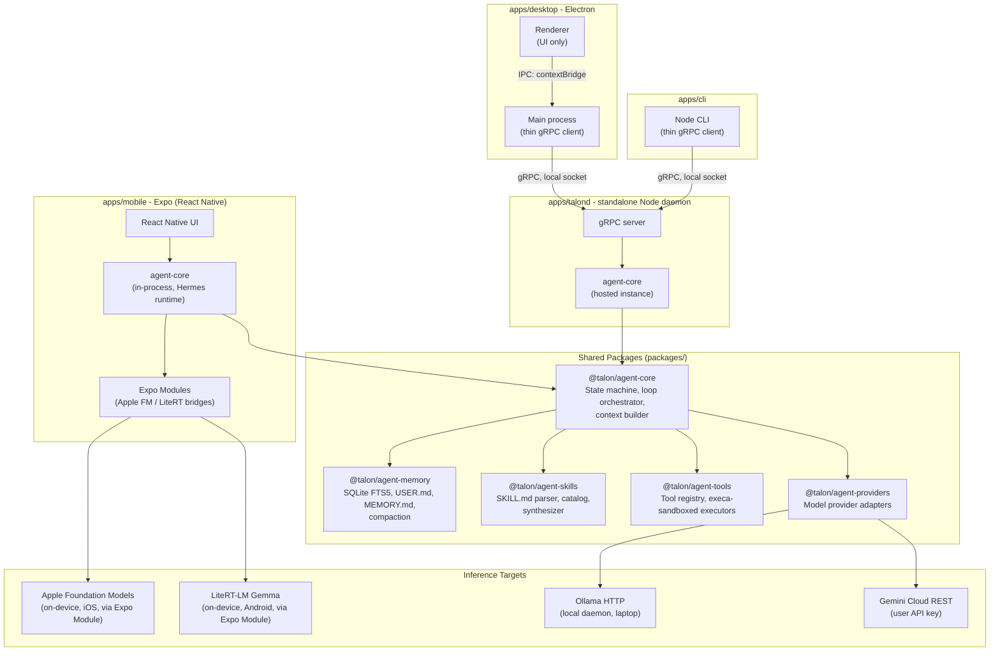
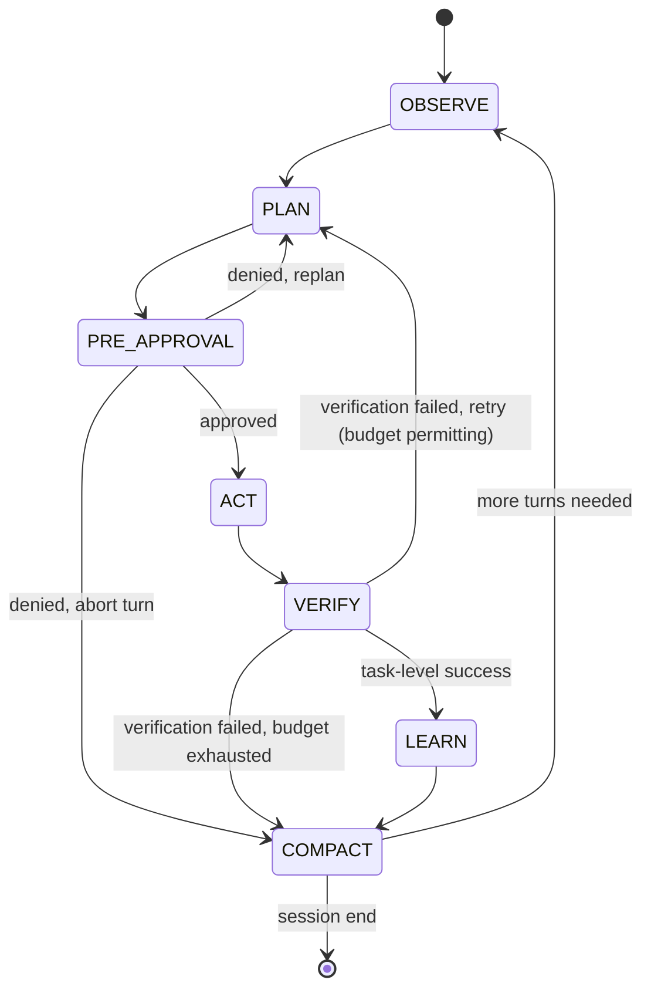
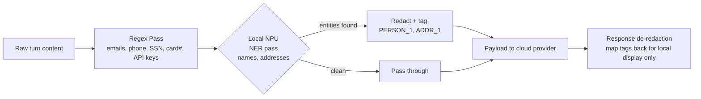
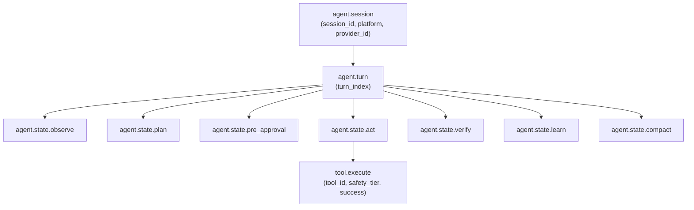
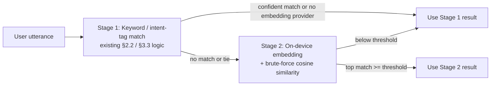
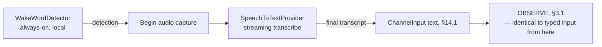

# Talon — Cross-Platform Modular AI Agent Harness
## Product Requirements Document & Technical Specification

**Status:** Draft v2.0 (TypeScript rewrite)
**Owner:** TBD
**Repo:** `talon-ts` (TypeScript monorepo, pnpm workspaces + Turborepo)

**Revision note:** v1.0 specified a Dart/Flutter implementation (Melos-managed, Flutter mobile + Dart CLI/daemon). This revision ports the same product and architecture to TypeScript, targeting **React Native (Expo) for mobile** and **Electron for desktop**, with a standalone Node.js daemon (`talond`) hosting the shared agent runtime. Every §-numbered section below maps 1:1 to its v1.0 counterpart; call-outs marked **[divergence]** flag places where the platform shift forced a real architectural change rather than a mechanical translation.

---

## 1. Executive Summary & Architecture Blueprint

### 1.1 Vision

Talon is a lightweight, extensible agent runtime that runs the *same* orchestration core on a phone, a laptop, or a headless server. A single TypeScript package (`@talon/agent-core`) defines the agentic loop, memory, skills, and tools; thin platform shells (React Native/Expo mobile, Electron desktop, Node CLI) attach to it. The runtime prefers on-device inference (Apple Foundation Models, Android LiteRT/Gemma, local Ollama) and escalates to Google Gemini Cloud only when local capability, context budget, or task complexity demands it — under a user-supplied API key, never a vendor-operated proxy.

**[divergence]** "The same orchestration core" means something slightly different than it did under Flutter. Flutter could compile one Dart codebase natively into both the phone app and a desktop daemon. React Native's JS runtime (Hermes) cannot host a Node.js process, and Electron's architecture splits into main/renderer processes that don't exist in Flutter at all. The resolution (detailed in §1.3/§1.4): `@talon/agent-core` is pure, dependency-free TypeScript with no Node-specific or browser-specific APIs — it runs **in-process inside the React Native app on mobile**, and **inside the standalone `talond` daemon on desktop/server**, with Electron itself reduced to a thin UI client of `talond` over gRPC. Same package, two runtimes, exactly as the "thin shells, shared core" principle intends — just not the literal single-binary story Dart offered.

### 1.2 Core Pillars

| Pillar | Source Influence | Talon Implementation |
|---|---|---|
| Progressive skill disclosure + self-authored skills | Hermes | `agent-skills`: `SKILL.md` catalog, lazy-loaded into context, runtime synthesizer writes new skills after successful novel task completion |
| Decoupled transport, clean session loops, independent verification | OpenClaw | `agent-core`: `Channel` interface abstracts input/output surface from the loop; `VERIFY` is a non-skippable state distinct from `ACT` |
| Daemon background execution, tiered safety gates, sandboxing | Meta Muse | `agent-tools` + `apps/talond`: long-running daemon process, 3-tier permission matrix, `execa`-restricted process executors |
| Hybrid local/cloud routing | Native hardware + Gemini | `agent-providers`: `ModelProvider` interface with capability negotiation and auto-escalation policy |
| Zero-leakage privacy | Design mandate | PII scrub pipeline runs client-side before any payload leaves the device, regardless of provider |

### 1.3 High-Level Architecture



**Dependency rule:** arrows only point from shells → shared packages → providers. No package under `packages/` may import from `apps/`. `agent-core` may not import `agent-providers` or `agent-tools` concretely — only their abstract interfaces, injected at the app layer (dependency inversion; see §2.2). This rule is enforced in CI by `eslint-plugin-boundaries` rather than a custom dependency-graph script (§2.3).

### 1.4 Multi-Target Deployment Strategy

| Dimension | Mobile (iOS/Android, Expo/RN) | Laptop/Server (macOS/Linux/Windows) |
|---|---|---|
| Process model | `agent-core` runs **in-process** inside the React Native app (Hermes JS engine) — no separate daemon, since RN cannot host a Node process **[divergence]** | `agent-core` runs **inside `talond`**, a standalone Node daemon; Electron and the CLI are thin gRPC clients that never host agent logic themselves |
| Primary inference | On-device NPU (Apple FM / LiteRT), reached via Expo Modules | Ollama (local GPU/CPU) preferred; cloud fallback |
| Tool execution | Sandboxed by OS app sandbox; no raw shell access | `execa`-wrapped subprocess (cwd pin, env allowlist, timeout, output caps), gated by permission tiers (§5) |
| Persistence | `expo-sqlite` database in app sandbox storage | `better-sqlite3` database under `~/.talon/` (XDG-style: `$XDG_DATA_HOME/talon` or `%APPDATA%\talon`) |
| Background execution | iOS: BGTaskScheduler (15 min budget); Android: WorkManager/foreground service | `talond` is a native daemon, unbounded runtime |
| Approval UI | `expo-local-authentication` biometric sheet (Face ID / BiometricPrompt) | TTY confirmation prompt (CLI) or Electron native notification |
| Network for cloud escalation | Required, user-initiated or auto per policy | Required, same policy |
| Reachable as a remote target (§15) | **Never** — mobile is always the initiator/client side of the remote-computer feature | Yes, via `talond`'s gRPC server over Tailscale |

The **same `@talon/agent-core` module** runs in both places; only the injected `Channel`, `ModelProvider` set, `ToolExecutor` sandboxing strategy, and *host runtime* (Hermes in-process vs. Node daemon) differ.

---

## 2. Monorepo Structure & Extensibility Standards

### 2.1 Full Directory Layout

```
talon-ts/
├── pnpm-workspace.yaml
├── turbo.json                          # task graph, caching
├── package.json                        # workspace root
├── tsconfig.base.json                  # shared compiler options
├── .eslintrc.cjs                       # shared lint rules + eslint-plugin-boundaries config
├── proto/
│   └── talon/
│       ├── agent_event.proto
│       ├── tool.proto
│       ├── provider.proto
│       └── daemon.proto                # talond's gRPC service definitions
├── packages/
│   ├── grpc-contracts/
│   │   ├── src/generated/              # ts-proto output (generated, not hand-written)
│   │   └── package.json
│   ├── agent-core/
│   │   ├── src/
│   │   │   ├── loop/
│   │   │   │   ├── agent-loop.ts        # orchestrator
│   │   │   │   ├── agent-state.ts       # discriminated union + transition fn
│   │   │   │   └── loop-budget.ts       # turn/token/time limits
│   │   │   ├── context/
│   │   │   │   ├── context-builder.ts
│   │   │   │   └── context-window.ts
│   │   │   ├── channel/
│   │   │   │   └── channel.ts           # abstract transport interface
│   │   │   ├── events/
│   │   │   │   └── agent-event.ts       # discriminated-union event types
│   │   │   └── index.ts                 # public barrel export
│   │   ├── test/
│   │   └── package.json
│   ├── agent-memory/
│   │   ├── src/{profile,episodic,fts,compaction}/
│   │   └── package.json
│   ├── agent-skills/
│   │   ├── src/{parser,catalog,loader,synthesizer}/
│   │   └── package.json
│   ├── agent-tools/
│   │   ├── src/{registry,base,sandbox,builtin}/
│   │   └── package.json
│   ├── agent-providers/
│   │   ├── src/{contract,apple-fm,android-litert,ollama,gemini}/
│   │   └── package.json
│   ├── agent-telemetry/
│   │   ├── src/{otel-bridge,span-mapper}/
│   │   └── package.json
│   ├── agent-voice/
│   │   ├── src/{wake-word,stt,channel}/
│   │   └── package.json
│   ├── agent-remote-env/
│   │   ├── src/{browser-backend,transport,tools}/
│   │   └── package.json
│   └── agent-memory-sync/
│       ├── src/{postgres-client,conflict,sync-engine}/
│       └── package.json
├── apps/
│   ├── talond/                          # standalone daemon — hosts agent-core
│   │   ├── src/
│   │   │   ├── main.ts                   # entrypoint; packaged via `pkg` into a single binary
│   │   │   ├── grpc-server.ts            # exposes agent-core over gRPC (proto/talon/daemon.proto)
│   │   │   └── sqlite/                   # better-sqlite3 wiring, Tier 3 store (§4.3)
│   │   └── package.json
│   ├── cli/
│   │   ├── src/bin/talon.ts              # CLI entrypoint, gRPC client to talond
│   │   └── package.json
│   ├── desktop/                          # Electron
│   │   ├── src/main/                      # main process: thin gRPC client, no agent logic
│   │   ├── src/renderer/                  # React UI
│   │   ├── src/preload/                   # contextBridge — the only renderer↔main seam
│   │   └── package.json
│   └── mobile/                           # Expo (React Native)
│       ├── modules/
│       │   ├── apple-fm-bridge/           # Expo Module (Swift)
│       │   └── litert-bridge/             # Expo Module (Kotlin)
│       ├── src/
│       │   ├── agent/                     # agent-core wired in-process, on-device
│       │   └── remote/                    # grpc-web client, used only for §15/§16
│       ├── app.json
│       └── package.json
├── infra/
│   └── envoy/
│       └── envoy.yaml                    # grpc-web proxy config, fronts talond for RN clients
└── tools/
    └── scripts/                          # turbo-aware bootstrap, proto codegen, release
```

**Boundary enforcement:** `eslint-plugin-boundaries` is configured in the root `.eslintrc.cjs` with element types (`core`, `package`, `app`) and a rule set forbidding `packages/*` from importing `apps/*`, and forbidding `agent-core` from importing any sibling package concretely (only type-only imports of their published interfaces are allowed). `turbo run lint` runs this across every workspace package and fails the build on violation — the direct TypeScript analogue of the original `melos run check:deps` step, but checking real import graphs rather than just `package.json` dependency declarations.

### 2.2 Plugin Contracts

These three interfaces are the **only** extension points. A contributor adding a tool, skill, or model provider never edits `agent-core`.

#### `ToolDefinition` (in `@talon/agent-tools`)

```typescript
/** Immutable description + executor binding for a single callable tool. */
export abstract class ToolDefinition {
  /** Unique, stable identifier. Namespaced: "fs.read_file", "shell.exec". */
  abstract readonly id: string;

  /** JSON Schema (draft 2020-12) describing the input the model must produce. */
  abstract readonly inputSchema: JsonSchema;

  /** Human-readable description injected into the model's tool-use prompt. */
  abstract readonly description: string;

  /**
   * Declared safety tier — the *floor* the approval gate (§5.1) applies.
   * Not necessarily the effective tier: `resolveTier` may raise it for a
   * specific call, but never lower it. This is what keeps §15.7's
   * target-dependent elevation on the laptop remote target consistent
   * with this contract rather than contradicting it.
   */
  abstract readonly safetyTier: ToolSafetyTier;

  /**
   * Resolves the *effective* tier for one specific call, given runtime
   * context (e.g. which remote target is active, §15.3). Defaults to
   * returning `safetyTier` unchanged — only tools whose risk genuinely
   * depends on call-time context (the `remote.*` family, §15.7) need to
   * override this. `ApprovalGate.request` (§5.1) always gates on
   * `resolveTier(ctx)`, never on the bare `safetyTier` getter directly.
   */
  resolveTier(ctx: ToolExecutionContext): ToolSafetyTier {
    return this.safetyTier;
  }

  /**
   * Pure validation of a candidate input against `inputSchema` plus any
   * tool-specific invariants. Must not perform I/O.
   */
  abstract validate(input: Record<string, unknown>): ToolValidationResult;

  /**
   * Executes the tool. Must be side-effect-isolated behind the
   * `ToolSandbox` the runtime injects — implementations never shell out
   * or touch the filesystem directly; they call through `ctx.sandbox`.
   */
  abstract execute(
    ctx: ToolExecutionContext,
    input: Record<string, unknown>,
  ): Promise<ToolResult>;
}

export enum ToolSafetyTier {
  SafeReadOnly = "safeReadOnly",
  HeuristicSandboxed = "heuristicSandboxed",
  DangerousConfirmRequired = "dangerousConfirmRequired",
}

export interface ToolExecutionContext {
  readonly sandbox: ToolSandbox;
  readonly cancellation: AbortSignal;
  readonly sessionId: string;
}

export type ToolResult =
  | { success: true; output: unknown; binaryOutput?: Uint8Array } // see §4.3 artifact storage
  | { success: false; errorCode: string; errorMessage: string };  // see §12 error code table
```

**Registration lifecycle (zero circular deps):**
1. New tool lives in `packages/agent-tools/src/builtin/<tool-name>.ts` (or an external package for third-party tools — `agent-tools` only depends on the `ToolDefinition` abstract class, not on any concrete tool).
2. Tool self-registers by exporting a singleton `ToolDefinition` instance added to `builtin/registry-manifest.ts`'s const array — no reflection, no global mutable registry.
3. `ToolRegistry` (in `agent-core`'s injected context) is constructed by the **app layer** (`apps/mobile` in-process, or `apps/talond` for every desktop/server client) at startup, which decides which tool set to pass in. `agent-core` only ever sees `ToolRegistry` as an interface over `ToolDefinition[]`.
4. No package reaches back up to re-import the registry — dependency direction stays app → registry → tool.

#### `BaseSkill` (in `@talon/agent-skills`)

```typescript
/** Parsed representation of a SKILL.md document plus its runtime hook. */
export abstract class BaseSkill {
  /** Matches the `id:` frontmatter field. Used for catalog lookups and synthesizer dedup. */
  abstract readonly id: string;

  /**
   * One-line trigger description shown in the *unexpanded* catalog index
   * that's always in context (progressive disclosure — see §4).
   */
  abstract readonly triggerSummary: string;

  /**
   * Full markdown body, only loaded into context when `shouldActivate`
   * returns true for the current turn's intent classification.
   */
  abstract readonly body: string;

  /**
   * Declarative trigger condition — keyword match, intent tag, or both.
   * Must be a pure function of `SkillActivationContext`; no I/O.
   */
  abstract shouldActivate(ctx: SkillActivationContext): boolean;

  /**
   * Optional structured tool-call sequence a skill can pre-register,
   * e.g. a skill that always calls `fs.read_file` then `shell.exec`.
   */
  get recommendedToolIds(): string[] {
    return [];
  }

  /** Provenance: "human" for human-authored, "synthesized" for auto-synthesized skills (§4.4). */
  abstract readonly origin: SkillOrigin;
}

export type SkillOrigin = "human" | "synthesized";

export interface SkillActivationContext {
  readonly userIntentSummary: string;
  readonly recentToolIds: string[];
  readonly activeSkillIds: ReadonlySet<string>;
}
```

**Lifecycle:** `SKILL.md` files live under `~/.talon/skills/*.md` (user + synthesized, on desktop/server) and under the mobile app's bundled asset catalog + on-device writable storage (user + synthesized, on mobile). Human-authored bundled skills ship as static assets in `packages/agent-skills/skills/*.md`, imported by whichever app packages them (Expo's asset pipeline on mobile, a plain file copy for `talond`). The `SkillCatalogIndexer` scans both roots at session start, parses frontmatter only (not full body) into an in-memory index — this is the "progressive disclosure" layer: the model sees only `triggerSummary` strings until `shouldActivate` fires, at which point `body` is injected into context for that turn only.

#### `ModelProvider` (in `@talon/agent-providers`)

```typescript
/** Adapter over one inference backend (on-device or cloud). */
export abstract class ModelProvider {
  abstract readonly providerId: string;        // "apple_fm", "litert_gemma", "ollama", "gemini"
  abstract readonly locality: ProviderLocality; // "onDevice" | "localDaemon" | "cloud"
  abstract readonly capabilities: ProviderCapabilities;

  /**
   * Only meaningful when `locality === "cloud"`. onDevice/localDaemon
   * providers always report `CloudTier.None`. Lets the router (§3.3)
   * distinguish a cheap/fast cloud model from a premium one generically,
   * without special-casing any single provider by name — a future
   * second cloud provider plugs into the same tier ladder for free.
   */
  get cloudTier(): CloudTier {
    return CloudTier.None;
  }

  /**
   * Cheap, synchronous-ish readiness probe (model downloaded, daemon
   * reachable, API key present) run before committing to this provider
   * for a turn. Must complete in <100ms budget on mobile.
   */
  abstract checkHealth(): Promise<ProviderHealth>;

  /**
   * Streaming completion. Implementations must surface partial
   * function-call deltas via `AgentEvent.toolCallDelta` through the
   * returned async iterable — not buffer the whole response.
   */
  abstract complete(request: ProviderRequest): AsyncIterable<ProviderChunk>;
}

export enum CloudTier {
  None = "none",
  Small = "small",
  Premium = "premium",
}

export interface ProviderCapabilities {
  readonly maxContextTokens: number;
  readonly supportsFunctionCalling: boolean;
  readonly supportsStreaming: boolean;
  readonly supportsVision: boolean;
}

export type ProviderLocality = "onDevice" | "localDaemon" | "cloud";
export type ProviderHealth = "ready" | "modelNotDownloaded" | "daemonUnreachable" | "authMissing" | "unsupported";
```

**Lifecycle:** adding a provider means implementing this contract in a new `agent-providers/src/<provider>/` subfolder and adding it to the app-layer `ProviderRoutingPolicy` construction (§3.3). `agent-core`'s loop orchestrator depends only on `ModelProvider` and a `ProviderRouter` interface it's handed — never on concrete adapters. Streaming uses native TS `AsyncIterable<T>` (consumed via `for await`) rather than an Rx/Observable library, keeping `agent-core` dependency-free.

### 2.3 Zero-Circular-Dependency Guarantee

```
apps/*  ──depends on──>  packages/agent-core
apps/*  ──depends on──>  packages/agent-memory, agent-skills, agent-tools, agent-providers (to WIRE them)
agent-core ──depends on (interfaces only)──> nothing concrete outside itself
agent-memory, agent-skills, agent-tools, agent-providers ──depends on──> agent-core (for shared primitives: AgentEvent, ids, errors)
```

`agent-core` defines the shared vocabulary (`AgentEvent`, `ToolResult`, error codes) in a small internal `agent-core/src/shared/` subtree with **no dependencies of its own**, which every other package imports. This avoids the common trap of a "common" package that other packages fight over — `agent-core` *is* the common package, and it never imports siblings back. `eslint-plugin-boundaries` encodes exactly this graph as its rule set, so a violation is a lint error at edit time, not a CI-only surprise.

`agent-telemetry` (§10) follows the identical rule: it depends only on `agent-core`'s shared `AgentEvent` types, and `agent-core` never imports it back. It is wired in by `apps/talond` as a pure `AgentEvent` subscriber, exactly like `agent-memory`/`agent-skills`/`agent-tools`/`agent-providers` are wired in as collaborators rather than upstream dependencies of the loop.

`agent-voice` (§14) sits on the opposite side of the same rule: it depends only on `agent-core`'s `Channel` interface (§14.1) and implements it, rather than `agent-core` depending on `agent-voice`. The app layer decides whether to construct a `VoiceChannel` alongside the existing text channel — `agent-core`'s loop is unaware a `Channel` implementation is backed by a microphone rather than a keyboard.

`agent-remote-env` (§15) depends only on `agent-tools`'s `ToolDefinition` contract (§2.2) — it supplies a `remote.*` tool family exactly like any other tool package under `builtin/`, just packaged separately given its transport/browser-backend complexity. Neither `agent-core` nor `agent-tools` imports it back; the app layer registers its tools into the `ToolRegistry` only when a remote target is configured, same lifecycle as every other `ToolDefinition`.

`agent-memory-sync` (§16) depends only on `agent-memory`'s schema/table definitions (§4.3) — it reads what `agent-memory` already wrote locally and replicates specific tables to a remote Postgres target, never the other way around. `agent-memory` carries no Postgres dependency and is entirely unaware sync exists, exactly like `agent-core`'s loop is unaware `agent-telemetry` is listening to its events — both are pure, optional, out-of-band observers of state another package already owns.

---

## 3. Agentic Loop & State Machine Specification

### 3.1 State Machine



| State | Responsibility | Exit Condition |
|---|---|---|
| `OBSERVE` | Ingest new user input + tool results from prior turn; classify intent; activate matching skills (§2.2) | Intent classified, context assembled |
| `PLAN` | Model call (streaming) produces a plan: narrative + zero or more proposed tool calls | Model emits `stop` or tool-call block |
| `PRE_APPROVAL` | Each proposed tool call is matched against its `ToolSafetyTier`; dangerous/heuristic calls route to the approval gate (§5.1) | All calls approved, denied, or timed out |
| `ACT` | Approved tool calls executed via `ToolSandbox`, in parallel where declared independent, sequential otherwise | All tool results collected or cancellation fired |
| `VERIFY` | Independent check: did tool output satisfy the plan's stated success criterion? Runs a cheap, deterministic check first (exit codes, schema match); falls back to a lightweight model self-check only if deterministic check is inconclusive | Pass/fail determined |
| `LEARN` | Post-task reflection (§4.4): was this a novel, successful, repeatable workflow? If so, draft a `SKILL.md` candidate | Reflection complete or skipped (budget) |
| `COMPACT` | Context compaction (§4.2) and session persistence to SQLite | Context under token ceiling, session row committed |

**Key design choice — `VERIFY` is never skipped:** unlike naive loops that treat tool success as task success, Talon always runs an explicit verification step, matching OpenClaw's independent-verification-gate principle. A tool call returning `ToolResult.success: true` only means the tool didn't error; `VERIFY` checks the *plan's* claim.

**Implementation shape (TypeScript, discriminated union + switch, not XState — a design-review decision):**

```typescript
export type AgentState =
  | { kind: "OBSERVE" }
  | { kind: "PLAN" }
  | { kind: "PRE_APPROVAL" }
  | { kind: "ACT" }
  | { kind: "VERIFY" }
  | { kind: "LEARN" }
  | { kind: "COMPACT" };

export type LoopTransitionEvent =
  | { type: "APPROVAL_GRANTED" }
  | { type: "APPROVAL_DENIED_REPLAN" }
  | { type: "APPROVAL_DENIED_ABORT" }
  | { type: "VERIFY_PASSED" }
  | { type: "VERIFY_FAILED_RETRY" }
  | { type: "VERIFY_FAILED_EXHAUSTED" }
  | { type: "MORE_TURNS" }
  | { type: "SESSION_END" };

export function transition(state: AgentState, event: LoopTransitionEvent): AgentState {
  switch (state.kind) {
    case "PRE_APPROVAL":
      switch (event.type) {
        case "APPROVAL_GRANTED": return { kind: "ACT" };
        case "APPROVAL_DENIED_REPLAN": return { kind: "PLAN" };
        case "APPROVAL_DENIED_ABORT": return { kind: "COMPACT" };
        default: throw new Error(`invalid event ${event.type} for PRE_APPROVAL`);
      }
    case "VERIFY":
      switch (event.type) {
        case "VERIFY_PASSED": return { kind: "LEARN" };
        case "VERIFY_FAILED_RETRY": return { kind: "PLAN" };
        case "VERIFY_FAILED_EXHAUSTED": return { kind: "COMPACT" };
        default: throw new Error(`invalid event ${event.type} for VERIFY`);
      }
    case "COMPACT":
      switch (event.type) {
        case "MORE_TURNS": return { kind: "OBSERVE" };
        case "SESSION_END": return state; // terminal — loop driver stops dispatching
        default: throw new Error(`invalid event ${event.type} for COMPACT`);
      }
    // OBSERVE -> PLAN, PLAN -> PRE_APPROVAL, ACT -> VERIFY, LEARN -> COMPACT
    // are unconditional and handled by the loop driver without an event.
    default:
      throw new Error(`no event-driven transition defined for ${state.kind}`);
  }
}
```

Exhaustiveness over `AgentState.kind` and `LoopTransitionEvent.type` is enforced by TypeScript's control-flow narrowing plus a `satisfies never` check in each `switch`'s `default` branch during code review — the direct analogue of Dart's sealed-class exhaustiveness checking, achieved through discriminated unions instead of a language feature.

### 3.2 Budgets & Termination

```typescript
export interface LoopBudget {
  readonly maxTurnsPerSession: number;        // default 40
  readonly maxToolCallsPerTurn: number;       // default 8
  readonly maxContextTokens: number;          // provider-dependent, see §2.2 capabilities
  readonly maxWallClockPerTurnMs: number;     // default 120_000 mobile / 600_000 daemon
  readonly maxVerifyRetries: number;          // default 2 (PLAN re-entry from VERIFY)
}
```

**Compaction triggers** (any one fires `COMPACT` mid-loop, not just at session end):
- Running context estimate exceeds 80% of `ProviderCapabilities.maxContextTokens`.
- Turn count since last compaction exceeds 10.
- A single tool result exceeds 4,000 tokens serialized (large file reads, command output) — summarized immediately rather than carried verbatim.

**Loop termination criteria** (any one ends the session, transitioning to a terminal state):
1. User-issued stop/cancel.
2. `maxTurnsPerSession` reached — session ends with a summary turn, not a silent cutoff.
3. `VERIFY` fails `maxVerifyRetries` times in a row for the same plan — surfaced to user as a blocked task, not retried indefinitely.
4. Unrecoverable provider error (auth revoked, daemon crash with no fallback available) — see error codes §12.

### 3.3 Fallback Escalation Rules: Local → Small Cloud → Premium Cloud

Talon routes across **three tiers**, not a binary local/cloud switch:

| Tier | `locality` | `cloudTier` | Example | Cost/Latency Profile |
|---|---|---|---|---|
| 0 — Local | `onDevice` / `localDaemon` | `none` | Apple FM, LiteRT Gemma, Ollama | Free, fastest, bounded by device hardware |
| 1 — Small Cloud | `cloud` | `small` | Gemini Flash-class model | Low cost, low latency, strong default cloud tier |
| 2 — Premium Cloud | `cloud` | `premium` | Gemini Pro-class model | Higher cost and latency; reserved for tasks that actually need it |

The exact model ID backing each cloud tier (e.g. which Flash/Pro snapshot) is **user-configurable at app-layer wiring time** (§2.2 lifecycle) — `agent-providers` fixes the *tier concept*, not a pinned model string, so a model rename or version bump never touches `agent-core`.

#### 3.3.1 Tier 0 → Tier 1/2: Local vs. Cloud

`ProviderRouter` evaluates, in order, for each `PLAN` state entry:

| Check | Local (Tier 0) wins if... | Escalates to Cloud (Tier 1 or 2, per §3.3.2) if... |
|---|---|---|
| Health | `checkHealth() === "ready"` | local provider returns `"modelNotDownloaded"` / `"daemonUnreachable"` |
| Context fit | estimated prompt tokens ≤ local `maxContextTokens` | prompt exceeds local window (e.g. long file content) |
| Capability | task doesn't require vision/function-calling beyond local support | task requires a capability flagged `false` locally |
| Complexity heuristic | §13.6's intent classifier assigns the `routine` bucket | §13.6's intent classifier assigns `complex` or `complex-premium` (see §3.3.2 for which cloud tier) |
| User policy | user has not set `forceCloud`/`forceLocal` override | — |
| Explicit user gesture | — | user explicitly invokes "think harder" / cloud-only skill |

Escalation is **never automatic for payloads containing unscrubbed PII** — the PII pipeline (§5.2) runs regardless of destination, but escalation additionally requires the user to have configured a Gemini API key; absent a key, the router has no cloud path and all tasks run local-only, degrading gracefully (surfacing `ErrorCode.PROVIDER_UNAVAILABLE` with a clear "add API key to enable cloud escalation" message rather than failing silently).

#### 3.3.2 Tier 1 → Tier 2: Small Cloud vs. Premium Cloud

Premium-tier routing is deliberately **not** driven by the small model's own self-reported confidence — that signal is unreliable and would need the small model to accurately judge its own failure modes, which is close to the problem being solved. Instead, two independent, more robust triggers apply:

1. **A priori — intent classification (§13.6):** the three-bucket nearest-exemplar classifier run during `OBSERVE` can assign `complex-premium` directly, routing straight to Tier 2 and skipping Tier 1 entirely for tasks recognized up front as needing it (e.g. long-horizon multi-file refactors, tasks explicitly naming a need for deep reasoning).
2. **A posteriori — `VERIFY` failure, retry 2 only (§3.1):** `VERIFY` failures no longer escalate tier unconditionally on the first failure — doing so would conflate "model wasn't capable enough" with "model made a fixable mistake" (wrong file path, malformed tool arg), burning a tier jump on something a same-tier retry would have fixed for free. Instead:
   - **Retry 1 (first `VERIFY` failure):** same-tier re-plan. The `VERIFY → PLAN` transition carries the verification failure reason as feedback injected into the new `PLAN` call, on the *same* provider — a normal retry-with-feedback loop, no tier change.
   - **Retry 2 (second consecutive `VERIFY` failure for the same turn):** *now* the `VERIFY → PLAN` transition carries a `nextTier` directive, escalating to the next higher tier rather than retrying same-tier again. A Tier 1 failure escalates to Tier 2; a Tier 0 failure escalates to Tier 1 (or directly to Tier 2 if the classifier already flagged `complex-premium`).

   This maps cleanly onto `LoopBudget.maxVerifyRetries`'s default of 2 (§3.2): one cheap same-tier retry, then one escalation — never two tier jumps spent on what might have been a one-off mistake.
3. **Explicit user override:** the same "explicit user gesture" row from §3.3.1 can target Tier 2 directly (e.g. a "use the best model" skill invocation), bypassing both the classifier and the retry/escalation sequence regardless of current tier.

**Re-plan strategy:** every tier *escalation* (as opposed to a same-tier retry) — Tier 0→1, Tier 0→2, or Tier 1→2 — is always a **full re-plan**: the loop re-enters `PLAN` with the complete original turn context on the new provider. There is no partial handoff of a lower tier's intermediate reasoning or tool state. This keeps the state machine simple and avoids needing to define a cross-provider "reasoning handoff" format, at the cost of re-incurring the lower tier's prompt-construction work — judged an acceptable trade-off since tier escalation is now a minority path even among retries (see NFR note, §7.3).

**Budget interaction:** both the same-tier retry and a tier escalation each consume one unit of the existing `maxVerifyRetries` budget (§3.2) — escalation is not an additional allowance stacked on top of the retry count. If `VERIFY` fails again at Tier 2 (the top of the ladder, with nowhere higher to escalate), the loop proceeds to `VERIFY_EXHAUSTED` exactly as already defined in §12.

---

## 4. Memory Hierarchy & Auto-Learning Loop

### 4.1 Tier 1 — Static Profile (`USER.md`)

Plain markdown, human-editable, loaded in full into every session's system context (bounded — see cap below).

```markdown
---
schema_version: 1
updated_at: 2026-10-10T00:00:00Z
---
# User Profile

## Identity
- Name: ...
- Timezone: ...

## Preferences
- Communication style: concise, no emoji
- Preferred languages: TypeScript, Python

## Standing Constraints
- Never commit directly to main
```

**Dynamic bound:** `USER.md` is capped at **2,000 tokens**. On write, `agent-memory`'s `ProfileWriter` enforces the cap by rejecting (not silently truncating) writes that would exceed it — the caller (`LEARN` state, or explicit user edit) must consolidate first. This file changes rarely and is never auto-compacted by the LLM — only explicit user-approved edits or user-initiated `/forget` commands mutate it.

**Cross-device sync:** `USER.md` is one of three tiers §16's optional `agent-memory-sync` replicates to a user-owned Postgres VM by default (§16.3) — it's small and clearly worth having identical across a phone and a laptop. Because it's directly edited rather than appended to, it's the one tier that uses last-write-wins conflict resolution (§16.4) rather than append-only merge.

### 4.2 Tier 2 — Episodic Knowledge (`MEMORY.md`)

Rolling log of durable facts learned across sessions, distinct from the full transcript (which lives in SQLite, Tier 3).

```markdown
---
schema_version: 1
max_entries: 200
---
# Episodic Memory

- [2026-10-01] Project `talon` uses pnpm workspaces + Turborepo.
- [2026-09-28] User prefers `rg` over `grep` for all searches.
```

**Auto-compaction algorithm** (runs during `COMPACT` state when entry count exceeds `max_entries`):
1. Score each entry by `recency_weight * reference_count` — `reference_count` increments each time a later session's `OBSERVE` step retrieves that entry via FTS (§4.3) and it influences a plan.
2. Entries below the 20th percentile score are candidates for pruning.
3. Candidates are **not deleted** — they're merged into a single summarized entry per topic cluster (simple keyword clustering, not embedding-based, to stay dependency-light) and the originals are archived into SQLite (`memory_archive` table) rather than lost.
4. The merge is itself logged as a `MEMORY.md` entry dated at compaction time, so the compaction is auditable.

This keeps `MEMORY.md` bounded (target: stays under ~6,000 tokens at 200 entries of ~30 tokens each) without ever hard-deleting information.

**Cross-device sync:** `MEMORY.md` entries also sync by default via §16's `agent-memory-sync`. Each entry is a distinct, uniquely-identified insert, so entries written by two devices while both offline don't conflict — they simply union together on the next sync (§16.4), unlike `USER.md`'s last-write-wins handling above.

### 4.3 Tier 3 — SQLite FTS5 Session Store

No external vector DB — full-text search over session transcripts gives sub-millisecond lookups for the recall patterns this loop actually needs (exact tool names, file paths, prior error messages), which is where Hermes's approach wins on simplicity.

**Library choice (settled during design review):** `better-sqlite3` on desktop/`talond` (synchronous, FTS5 enabled by its bundled SQLite build); `expo-sqlite` on mobile, where `agent-core` runs in-process (§1.3) and therefore needs its own local store identical in schema. FTS5 availability in `expo-sqlite`'s bundled SQLite build is a **confirm-early risk**, tracked in §7.3, mirroring how the original Dart PRD flagged the same risk for `sqlite3_flutter_libs`.

```sql
CREATE TABLE sessions (
  session_id   TEXT PRIMARY KEY,
  started_at   INTEGER NOT NULL,   -- unix millis
  ended_at     INTEGER,
  platform     TEXT NOT NULL,      -- 'ios' | 'android' | 'macos' | 'linux' | 'windows'
  provider_id  TEXT NOT NULL       -- last provider used
);

CREATE TABLE turns (
  turn_id      TEXT PRIMARY KEY,
  session_id   TEXT NOT NULL REFERENCES sessions(session_id),
  turn_index   INTEGER NOT NULL,
  role         TEXT NOT NULL,      -- 'user' | 'assistant' | 'tool'
  content      TEXT NOT NULL,      -- raw text (PII already scrubbed before cloud, original kept locally).
                                    -- For a tool result carrying ToolResult.binaryOutput (§2.2), this holds a
                                    -- short searchable placeholder (e.g. "[screenshot: artifact_id]"), never
                                    -- the binary bytes themselves — see the artifacts table below.
  tool_id      TEXT,
  created_at   INTEGER NOT NULL
);

CREATE VIRTUAL TABLE turns_fts USING fts5(
  content,
  content='turns',
  content_rowid='rowid',
  tokenize='porter unicode61'
);

-- trigger-maintained sync: AFTER INSERT/UPDATE/DELETE ON turns -> turns_fts

CREATE TABLE artifacts (
  artifact_id   TEXT PRIMARY KEY,
  turn_id       TEXT NOT NULL REFERENCES turns(turn_id),
  mime_type     TEXT NOT NULL,      -- e.g. 'image/png' for a §15.4 screenshot
  file_path     TEXT NOT NULL,      -- bytes live on disk under ~/.talon/artifacts/<artifact_id>, not in SQLite
  size_bytes    INTEGER NOT NULL,
  created_at    INTEGER NOT NULL
);

CREATE TABLE memory_archive (
  entry_id     TEXT PRIMARY KEY,
  archived_at  INTEGER NOT NULL,
  original_text TEXT NOT NULL,
  merged_into  TEXT                -- entry_id of the MEMORY.md summary it was folded into
);

CREATE TABLE skills_synthesized (
  skill_id     TEXT PRIMARY KEY,
  created_at   INTEGER NOT NULL,
  status       TEXT NOT NULL,      -- 'draft' | 'approved' | 'rejected'
  source_session_id TEXT NOT NULL REFERENCES sessions(session_id)
);
```

Query pattern used by `OBSERVE`: `SELECT turn_id, content FROM turns_fts WHERE turns_fts MATCH ? ORDER BY rank LIMIT 10` — BM25 ranking built into FTS5, no additional scoring layer needed. Benchmarked target: <5ms for a 50k-turn history on mobile hardware (SQLite on-device, indexed).

**Cross-device sync scope (§16):** of the tables above, only `skills_synthesized` rows with `status = 'approved'` sync by default — a skill learned on the laptop should be usable on mobile. `turns` (and its `artifacts`) stay local-only unless the user opts in (§16.3), since full transcripts are the largest, highest-volume, lowest cross-device-value tier. `embedding_cache` (§13.5) and `memory_archive` never sync — both are cheap to regenerate or are purely local audit trails, not data anyone needs mirrored.

### 4.4 Auto-Learning: Skill Synthesis Specification

Runs in the `LEARN` state, gated so it never blocks turn latency (fires via `setImmediate`/a microtask on Node, or a non-blocking async task on the RN side, result persisted before `COMPACT` finalizes but not awaited by the user-facing response).

**Trigger conditions** (all must hold):
1. `VERIFY` passed for the task.
2. The plan's tool-call sequence has **no matching entry** in the existing skill catalog (checked via `recommendedToolIds` sequence similarity, not fuzzy text match — cheap and deterministic).
3. The plan involved ≥2 tool calls (single-call tasks aren't worth skill-ifying).

**Draft → Evaluate → Write pipeline:**
1. **Draft:** the model (same provider as the task, or local if available to save cost) is prompted with the successful turn's plan + tool sequence + verification outcome, asked to produce a `SKILL.md` candidate matching the standard frontmatter schema:
   ```markdown
   ---
   id: skill.deploy_preview_branch
   trigger_summary: "Deploy a feature branch to a preview environment"
   origin: synthesized
   source_session_id: 9f2e...
   confidence: 0.82
   ---
   # Deploy Preview Branch
   1. Run `fs.read_file` on `vercel.json` to confirm config exists.
   2. Run `shell.exec` with `vercel deploy --prebuilt`.
   3. Verify by checking the returned URL responds 200.
   ```
2. **Evaluate:** candidate is scored against two gates before it touches disk — (a) `confidence >= 0.6` (model's own self-reported confidence, from a structured output field), and (b) no `dangerousConfirmRequired` tool appears in the skill without that tier being preserved (synthesis cannot silently downgrade a tool's *declared* `safetyTier`, §2.2). Failing either gate discards the draft. This check only ever sees the declared tier, not the resolved one — a skill recommending a `remote.*` tool (§15.6) can't know at draft time which target it'll later run against, so it can't evaluate `resolveTier`'s target-dependent outcome (§15.7) either. That's fine: `PRE_APPROVAL`'s `ApprovalGate` independently re-resolves the effective tier at execution time regardless of what synthesis assumed (§5.1) — these are two non-overlapping safety nets, not one that needs to anticipate the other.
3. **Write:** passing candidates are written to `~/.talon/skills/<id>.md` (desktop/server) or the mobile app's writable document directory with `status: draft` in the `skills_synthesized` SQLite row. **Drafts never auto-activate** — they surface once, non-blockingly, as "Talon learned a new skill: review?" and only flip to `status: approved` (and thus become eligible for `shouldActivate`) on explicit user confirmation. This mirrors the PRE_APPROVAL gate philosophy: autonomous synthesis, human-gated activation.

---

## 5. Security Sandbox, PII Scrubbing, & Approval Gates

### 5.1 Tiered Permissions Matrix

| Tier | Examples | Execution Path | Confirmation |
|---|---|---|---|
| **Safe / read-only** | `fs.read_file`, `fs.list_dir`, `memory.search` | Direct execution, no gate | None — logged only |
| **Heuristic / sandboxed** | `shell.exec` (allowlisted commands: `git status`, `npm test`), `fs.write_file` (within project dir) | Runs through `ToolSandbox`, backed by `execa` on desktop (process isolation via restricted spawn args) with resource limits (CPU/time/output size); simulated capability check on mobile | Auto-allow if matches a learned "safe pattern" cache; otherwise single lightweight in-flow confirmation (not biometric) |
| **Dangerous / confirm required** | `shell.exec` (arbitrary/unlisted commands), `fs.delete`, network calls to non-allowlisted hosts, any cloud escalation carrying content the PII scrubber flagged as high-confidence sensitive | Blocked at `PRE_APPROVAL` until explicit gate clears | **Mandatory** biometric (Face ID/Touch ID/BiometricPrompt via `expo-local-authentication`) on mobile; explicit typed confirmation (`y/N` plus command echo) on CLI; native Electron dialog on desktop. No auto-allow cache ever applies to this tier. |

This matrix governs local tools. The `remote.*` tool family (§15) uses the same three tiers and the same `ApprovalGate`, but §15.7 defines a **raised minimum floor** for one of its two execution targets, implemented via `ToolDefinition.resolveTier` (§2.2) rather than a special case — the matrix isn't duplicated there, just resolved with a stricter floor for a specific target.

```typescript
export class ApprovalGate {
  /**
   * Always gates on tool.resolveTier(ctx) (§2.2) — never on the bare
   * safetyTier getter — so any call-time elevation (e.g. §15.7's
   * target-dependent floor) is what's actually enforced, not the
   * tool's static declared tier.
   *
   * Returns immediately for "safeReadOnly". For "heuristicSandboxed",
   * checks the auto-allow cache keyed by (toolId, argHash) before
   * prompting. For "dangerousConfirmRequired", always prompts and
   * never caches the approval — every occurrence requires a fresh
   * confirmation.
   */
  async request(
    call: ProposedToolCall,
    ctx: ToolExecutionContext,
  ): Promise<ApprovalDecision> {
    throw new Error("not implemented — illustrative signature");
  }
}

export type ApprovalDecision = "approved" | "denied" | "timedOut";
```

**Sandbox isolation (desktop):** `ToolSandbox` on `apps/talond` shells out via `execa` with: cwd pinned to the project root (no `..` escape), env var allowlist (no credential leakage into subprocess env), wall-clock timeout, and stdout/stderr size caps enforced by the sandbox wrapper itself, not trusted to the tool. This is parity with the original design's level of isolation (restricted subprocess, not a full OS-level sandbox or container) — a deliberate scope decision made during the TS rewrite's design review rather than an upgrade. Mobile has no raw shell at all — `heuristicSandboxed` tools there are limited to in-process, OS-mediated operations (app sandbox file I/O).

### 5.2 Zero-Leakage PII Scrubbing Pipeline

Runs **unconditionally** before any payload crosses a process/network boundary to a non-local provider — i.e., before the `gemini` adapter serializes a request, never before `apple_fm`/`litert_gemma`/`ollama` (which are on-device/local-network only and don't need it, though the regex layer still runs for audit logging).



- **Regex pass** (deterministic, always on): emails, phone numbers (E.164 + common US formats), SSNs, credit card numbers (Luhn-validated), common cloud API key patterns (`sk-`, `AKIA`, etc.).
- **Local NER pass** (on-device model, same NPU path as inference — Apple FM / LiteRT, reached via the Expo Module bridges, run in a lightweight classification mode): catches names, physical addresses, and other unstructured PII the regex layer can't.
- **Redaction tagging:** entities are replaced with stable placeholder tokens (`PERSON_1`, `ADDR_1`) scoped per-turn, not globally — the mapping table lives only in local memory for that turn and is used to de-redact the model's response before displaying it to the user, so the user never sees jarring placeholder text, but the cloud provider never sees the raw value either.
- **Fail-closed:** if the local NER pass is unavailable (model not loaded) and the task is about to escalate to cloud, the scrubber falls back to regex-only but flags the payload `piiConfidence: "unverified"`, which **forces** that specific tool call into the `dangerousConfirmRequired` tier regardless of its declared tier — the user explicitly confirms sending unverified content to cloud.

### 5.3 Cloud Guardrail Configuration

Gemini API calls are configured with the minimal safety thresholds the API exposes, since Talon's own approval-gate and PII-scrub layers are the actual safety boundary — stacking aggressive content-filter false-positives on top of a tool-use agent mostly produces broken function calls, not safety:

```typescript
export const geminiSafetySettings = [
  { category: "HARM_CATEGORY_HARASSMENT", threshold: "BLOCK_NONE" },
  { category: "HARM_CATEGORY_HATE_SPEECH", threshold: "BLOCK_NONE" },
  { category: "HARM_CATEGORY_SEXUALLY_EXPLICIT", threshold: "BLOCK_NONE" },
  { category: "HARM_CATEGORY_DANGEROUS_CONTENT", threshold: "BLOCK_NONE" },
] as const;
```

This configuration is only reachable because the user supplies their own API key directly to Google — Talon is never an intermediary processing other users' traffic, so this is a single-user local-agent configuration choice, not a hosted-service policy. The approval-gate matrix (§5.1) remains the binding safety control regardless of model-level filtering.

---

## 6. Cross-Platform Provider & Execution Strategy

### 6.1 iOS Bridge — Apple Foundation Models

```swift
// apps/mobile/modules/apple-fm-bridge/ios/AppleFMModule.swift
public class AppleFMModule: Module {
  // Expo Module exposing availability/session/streaming methods to the
  // JS side as async functions + an event emitter for streamed tokens,
  // replacing Flutter's EventChannel/MethodChannel pairing.
  public func definition() -> ModuleDefinition {
    Name("AppleFMBridge")
    AsyncFunction("checkAvailability") { () -> String in /* .available | .modelNotReady | .unsupportedDevice */ }
    AsyncFunction("createSession") { (instructions: String) -> String in /* returns sessionHandle */ }
    Events("onResponseChunk")
    AsyncFunction("streamResponse") { (handle: String, prompt: String, toolsJson: String) in
      // emits "onResponseChunk" events as FMResponseChunk JSON, then resolves on completion
    }
  }
}
```

TypeScript side (`packages/agent-providers/src/apple-fm/apple-fm-provider.ts`) implements `ModelProvider` over this module, translating `ProviderRequest`/`ProviderChunk` to/from the module's JSON wire format and its event emitter into an `AsyncIterable<ProviderChunk>`. `checkHealth()` maps `AppleFMAvailability` directly to `ProviderHealth`. Apple's `LanguageModelSession` on-device constraints (context window, no custom fine-tuning) are reflected honestly in `ProviderCapabilities.maxContextTokens` — the router (§3.3) uses this to decide fit, not a hardcoded assumption.

### 6.2 Android Bridge — LiteRT-LM Gemma

```kotlin
// apps/mobile/modules/litert-bridge/android/LiteRtModule.kt
class LiteRtModule : Module() {
  // Model file resolved from Expo asset bundling or on-demand download
  // (Play Asset Delivery) depending on model size tier (Gemma 2B vs larger).
  override fun definition() = ModuleDefinition {
    Name("LiteRtBridge")
    AsyncFunction("loadModel") { variant: String -> /* LoadResult */ }
    Events("onGenerationChunk")
    AsyncFunction("generate") { sessionId: String, prompt: String, toolsJson: String ->
      // emits "onGenerationChunk" events, resolves on completion
    }
  }
}
```

Same adapter pattern as §6.1, authored as an Expo Module rather than a raw React Native native module (bare `Turbo Modules`) — consistent with the Expo-foundation decision in §2.2. Key difference: LiteRT model loading is explicit and can fail with a distinct `"modelNotDownloaded"` health state (handled by prompting the user to download via a Wi-Fi-only policy, surfaced through the app UI, not silently retried).

### 6.3 Laptop Daemon — Ollama HTTP Client

```typescript
// packages/agent-providers/src/ollama/ollama-provider.ts
export class OllamaProvider extends ModelProvider {
  readonly providerId = "ollama";
  readonly locality: ProviderLocality = "localDaemon";
  constructor(private readonly baseUrl = new URL("http://127.0.0.1:11434")) { super(); }

  get capabilities(): ProviderCapabilities {
    return {
      maxContextTokens: 8192, // model-dependent; a full implementation queries /api/show per loaded model
      supportsFunctionCalling: true,
      supportsStreaming: true,
      supportsVision: false,
    };
  }

  async checkHealth(): Promise<ProviderHealth> {
    try {
      const res = await fetch(new URL("/api/tags", this.baseUrl), { signal: AbortSignal.timeout(2000) });
      return res.ok ? "ready" : "daemonUnreachable";
    } catch {
      return "daemonUnreachable";
    }
  }

  async *complete(request: ProviderRequest): AsyncIterable<ProviderChunk> {
    const res = await fetch(new URL("/api/chat", this.baseUrl), {
      method: "POST",
      body: JSON.stringify(toOllamaPayload(request)),
    });
    yield* parseNdjsonStream(res.body!);
  }
}
```

Pairs with the **execa-wrapped shell tool executor** (`packages/agent-tools/src/builtin/shell-exec.ts`), which is only registered by the app layer on desktop targets (never on mobile — see §5.1). The executor enforces the sandbox described in §5.1 regardless of which provider requested it.

`talond` carries a second responsibility beyond hosting the local `OllamaProvider`: it's also the execution target §15's remote-computer feature connects *into* — the same daemon, same `ToolSandbox`, reached over a Tailscale transport instead of (or in addition to) the local gRPC socket. §6.3 defines what `talond` *is*; §15 defines the network-reachable, remotely-driven mode it can also run in.

### 6.4 Google Gemini Cloud REST Adapter

```typescript
// packages/agent-providers/src/gemini/gemini-provider.ts
export class GeminiProvider extends ModelProvider {
  readonly providerId = "gemini";
  readonly locality: ProviderLocality = "cloud";

  constructor(
    public readonly cloudTier: CloudTier, // small vs. premium (§3.3)
    private readonly modelId: string,      // e.g. a Flash-class id for small, Pro-class for premium
  ) { super(); }

  get capabilities(): ProviderCapabilities {
    return {
      maxContextTokens: 1_000_000, // model-dependent, queried from model metadata endpoint
      supportsFunctionCalling: true,
      supportsStreaming: true,
      supportsVision: true,
    };
  }

  async checkHealth(): Promise<ProviderHealth> {
    return process.env.GEMINI_API_KEY ? "ready" : "authMissing";
  }

  async *complete(request: ProviderRequest): AsyncIterable<ProviderChunk> {
    const body = {
      contents: toGeminiContents(request.messages),
      tools: [{ functionDeclarations: toFunctionDecls(request.tools) }],
      safetySettings: geminiSafetySettings, // §5.3
      generationConfig: { temperature: request.temperature },
    };
    // Server-Sent Events stream over POST /v1/models/{modelId}:streamGenerateContent?alt=sse
    yield* parseSseStream(this.modelId, body).map(parseGeminiChunk);
  }
}

// App-layer wiring (§3.3): two instances, one per cloud tier.
const geminiSmall = new GeminiProvider(CloudTier.Small, config.geminiSmallModelId);
const geminiPremium = new GeminiProvider(CloudTier.Premium, config.geminiPremiumModelId);
```

Function-calling deltas are parsed incrementally per SSE event and surfaced as `AgentEvent.toolCallDelta` so the `agent-core` loop can begin `PRE_APPROVAL` staging before the full response completes, matching the streaming contract declared in §2.2's `ModelProvider.complete`.

---

## 7. Non-Functional Requirements & Milestones

### 7.1 Size, Memory, Latency Targets

**[divergence]** Several targets from the Dart version don't survive the platform shift unchanged — Electron and `pkg`-bundled Node binaries are structurally larger and heavier than Flutter/Dart AOT output. The table below states honest, revised targets rather than carrying over numbers that no longer apply.

| Metric | Target | Notes |
|---|---|---|
| Expo (React Native) mobile bundle size | < 40 MB (per-platform, post-split) | Revised up from the Dart `<25MB` target — RN/Hermes + Expo's runtime footprint is larger than Flutter's; excludes on-device model weights (downloaded separately) |
| `talond` daemon binary size (`pkg`-bundled) | < 70 MB | Revised up substantially from Dart's `<10MB` — a `pkg` bundle embeds a full Node runtime, which Dart's AOT compiler doesn't need to |
| Electron desktop app installed size | < 200 MB | New metric — no Dart equivalent, since Flutter desktop didn't carry Chromium. Driven almost entirely by Electron's bundled Chromium + Node runtime, not by Talon's own code |
| Idle memory footprint (mobile) | < 150 MB resident | Excludes active model inference memory, which is OS-managed (Apple FM / LiteRT runtime) |
| Idle memory footprint (Electron desktop, renderer + main) | < 250 MB resident | Revised up from Dart's `<80MB` daemon-only figure — Chromium's renderer process alone typically exceeds that; `talond` itself (headless, no Chromium) targets the original `<80MB` figure independently, see next row |
| `talond` daemon idle memory (headless, no Electron attached) | < 80 MB resident | Unchanged from the Dart daemon target — `talond` itself has no Chromium dependency; this is what a CLI-only or remote-target-only deployment actually costs |
| `OBSERVE` → first streamed token (local provider) | < 800 ms p50 on reference hardware (iPhone 14 / M-series laptop) | Cold skill-catalog load excluded from steady-state measurement |
| FTS5 session search | < 5 ms p95 at 50k indexed turns | Per §4.3 — contingent on confirming FTS5 ships in `expo-sqlite`'s build (§7.3 risk) |
| Wake-word detection latency | < 300 ms from utterance end to listening-for-command state | On-device keyword spotting, §14.3 |
| Wake-word false-accept rate | < 1 per 24h of ambient audio | Standard KWS benchmark range; validated per-platform during Phase 5 (§7.2) |
| Wake-word false-reject rate | < 5% of genuine wake-phrase utterances | Same validation pass as above |
| Cloud escalation round-trip to first token | < 1.5 s p50 (network-dependent, not controllable, tracked as an SLO not a hard requirement) | |

### 7.2 Phased Implementation Roadmap

| Phase | Scope | Exit Criteria |
|---|---|---|
| **Phase 1 — Core Engine & CLI** | `agent-core` state machine, `agent-tools` registry + safe/heuristic tiers, `apps/talond` daemon + `apps/cli` client with Ollama provider only, gRPC wiring between them, no memory persistence beyond in-process | CLI can run a multi-turn tool-using session against local Ollama end-to-end over gRPC, with working `PRE_APPROVAL` gate on CLI prompts |
| **Phase 2 — Memory & Skills** | `agent-memory` (USER.md, MEMORY.md, SQLite FTS5 via `better-sqlite3`), `agent-skills` (parser, catalog, progressive disclosure), synthesizer draft pipeline (no auto-write yet — logged only) | Sessions persist and are searchable across `talond` restarts; bundled skills load and activate correctly; synthesizer produces reviewable drafts |
| **Phase 3 — Electron Desktop & Mobile Shells** | `apps/desktop` (Electron, thin gRPC client to `talond`), `apps/mobile` (Expo scaffold with `agent-core` wired in-process, Gemini Cloud as the only provider initially — local NPU deferred to Phase 4), biometric approval gate on mobile, mobile-safe tool subset (no shell_exec) | Feature-parity chat/task flow on iOS + Android + desktop; confirm `expo-sqlite` FTS5 availability (§7.3 risk) before this phase closes |
| **Phase 4 — Local NPU Integration & Semantic Routing** | Apple FM Expo Module, LiteRT Expo Module, full `ProviderRouter` escalation logic (§3.3) including the three-tier Local→Small Cloud→Premium Cloud ladder; PII scrub pipeline with local NER pass; `EmbeddingProvider` implementations (§13.3) sharing the same Expo Module bridges landed in this phase; the two-stage skill-activation pipeline and three-bucket intent classifier (§13.6) | On-device inference is default path on supported hardware; cloud escalation only fires per router rules; PII scrubber passes a defined red-team test set with zero raw-PII leakage to cloud payloads; semantic fallback (§13.2) correctly activates skills and classifies intent on utterances with no literal keyword match, degrading gracefully to Stage 1 only when `EmbeddingProvider` is unhealthy (§13.7) |
| **Phase 5 — Voice Interface** | `agent-voice` package (§14.2); `WakeWordDetector` + `SpeechToTextProvider` Expo Module bridges per platform (§14.3/§14.4, reusing the on-device model pipeline landed in Phase 4); local Whisper-class sidecar process managed by `talond` on desktop; `VoiceChannel` wired into `apps/mobile` and `apps/talond` as a second `Channel` implementation alongside text (§14.1) | "Hey Feedmind, …" activates end-to-end on all three targets within each platform's background-listening constraint (§14.6: foreground-only iOS, foreground-service Android, unrestricted daemon on desktop); wake-word false-accept/false-reject rates meet the §7.1 targets; a privacy audit confirms zero raw audio ever leaves the device |
| **Phase 6 — Remote Computer** | `agent-remote-env` package (§15.2); Tailscale-reachable gRPC transport + shared-secret auth added to `talond` (§15.5); Envoy/Connect grpc-web proxy deployed in front of `talond` for mobile clients; `BrowserAutomationProvider` with both backends (extension-bridge for laptop via a Manifest V3 Chrome extension, headless-CDP via `playwright-core`/`puppeteer-core` for the cloud VM, §15.4); `remote.*` tools (§15.6) registered on all platforms including mobile | A phone session can explicitly connect to either a BYO cloud VM or a Tailscale-reachable laptop and drive the configured browser/shell target over grpc-web; the raised approval floor on the laptop target (§15.7) and mandatory per-image confirmation on screenshots (§15.8) are enforced in practice, not just specified; target switching is always visible, never silent |
| **Phase 7 — Cross-Device Memory Sync** | `agent-memory-sync` package (§16.2); direct native-auth Postgres connection over Tailscale from `talond` (§16.5); per-tier conflict resolution (§16.4); pending-sync visibility indicator (§16.7); mobile's sync path relayed through a reachable `talond` instance rather than a direct Postgres connection (§16.5's divergence note) | `USER.md`, `MEMORY.md`, and approved skills converge correctly between a phone and a laptop pointed at the same BYO Postgres VM, including after one device was offline; a skill approved on one device is usable on the other without a restart-triggered re-sync; the device remains fully functional offline, with sync resuming transparently on reconnect |

### 7.3 Open Trade-offs Requiring Decision

**Revision note:** the first draft of this section inherited a single "...Before Phase 3" header from the original Dart PRD and tagged every item under it, including one explicitly scoped to Phase 6 — a direct contradiction (something that only matters at Phase 6 doesn't need resolving before Phase 3). Each item below instead carries its own phase tag.

- **Skill asset packaging** *(resolve before Phase 3)*: bundling human-authored `SKILL.md` files via Expo's asset pipeline vs. fetching them from a remote catalog at runtime — affects the §7.1 mobile bundle-size target if the catalog grows. This item existed in the original Dart/Flutter PRD and was dropped without resolution in the first TS draft; it applies unchanged here, since Expo's asset system has the identical trade-off Flutter assets did (bundling ties catalog growth to binary size; remote fetch avoids that at the cost of a cold-start network dependency the on-device path otherwise never needs).
- **FTS5 availability in `expo-sqlite`** *(resolve before Phase 3 — not Phase 2)*: confirm the bundled SQLite build includes FTS5 (not guaranteed across versions). The first draft scoped this check to "early in Phase 2," which is impossible to act on: `apps/mobile` isn't scaffolded until Phase 3 (§7.2), so there's no `expo-sqlite` instance to test against any earlier. If FTS5 is missing, fallback is `op-sqlite` (the alternative considered during design review, §4.3) purely for its FTS5/extension guarantees. `better-sqlite3` on `talond` carries no equivalent risk — its bundled SQLite build enables FTS5 by default — so there is nothing to validate on the Phase 1/2 desktop-only path; this is a mobile-only risk.
- **Envoy vs. Connect-RPC's built-in grpc-web adapter** *(resolve before Phase 6)*: the design review behind this document settled on "a grpc-web-compatible proxy (Envoy, or Connect's grpc-web adapter)" without actually picking one — both are referenced in §15.5 and §16.2 as if interchangeable, but they're operationally different. Envoy is a separate, independently-run proxy process with its own config and failure modes; Connect-RPC's grpc-web adapter can run inside `talond`'s own server process, meaning no second piece of infrastructure to deploy or keep alive at all. The latter fits this PRD's repeated "BYO infrastructure, zero managed backend, minimal moving parts" stance (§1.2, §15.1, §16.1) noticeably better, but that preference hasn't actually been put to the user the way every other architectural choice in this document was — it should be before Phase 6 commits to one.
- **`pkg` bundle size and startup time for `talond`** *(resolve before Phase 1 ships)*: embedding a full Node runtime per-platform multiplies binary size (§7.1); validate actual `pkg` output size against the <70MB target early, since a miss here cascades into distribution/update-size decisions for Phase 1's CLI-only release.
- **Electron installed-size and idle-memory targets** *(resolve before Phase 3)*: these are structurally driven by Chromium, not by Talon's own code (§7.1) — track early whether product stakeholders accept a ~200MB/250MB-class desktop app, since there is no code-level lever that gets Electron meaningfully below those figures.
- **grpc-web proxy operational overhead** *(resolve before Phase 6 — this does not block Phase 3)*: whichever proxy approach wins the item above, it's new infrastructure the user must run (or Talon must auto-provision) specifically to let mobile reach `talond` for the remote-computer feature (§15) and the memory-sync relay path (§16.2). Mobile's own on-device agent loop never needs this proxy at all, which is precisely why this item is a Phase 6 gate, not a Phase 3 one — conflating the two in the first draft overstated how early this needs solving.

**Premium-cloud-tier escalation rate as a tuning signal:** escalating from Tier 1 (small cloud) to Tier 2 (premium cloud, §3.3.2) trades latency and API cost for capability, and is designed to be the minority path — most turns should resolve at Tier 0 or Tier 1. The `tier_escalated` telemetry attribute (§10.2) makes this observable per session; a disproportionately high escalation rate is a signal that the Tier 1 model, its prompting, or the §13.6 intent classifier's exemplar set needs tuning, not an expected steady state. No numeric target is fixed here — establish a baseline from Phase 2/3 telemetry before setting one.

---

## 10. Observability: `agent-telemetry`

### 10.1 Package Role

`agent-telemetry` is a pure subscriber package: it depends only on `agent-core`'s shared `AgentEvent` types (§11) and translates the already-existing event stream into OpenTelemetry spans and metrics via the **OpenTelemetry JS SDK** (`@opentelemetry/sdk-node`). It is wired in **only inside `apps/talond`** — not Electron, not React Native — since `agent-core` only runs as a hosted instance there on desktop/server, and the design goal (§7.1's bundle-size discipline, confirmed during design review) is to keep Electron's renderer and the mobile bundle free of any added instrumentation surface. No other package makes OTel SDK calls directly — a contributor adding a new tool or provider never has to think about tracing, because every `AgentEvent` they emit is automatically observable. This keeps the acyclic dependency rule from §2.3 intact: `agent-telemetry` sits beside `agent-memory`/`agent-skills`/`agent-tools`/`agent-providers` as an app-wired collaborator, never an upstream dependency of `agent-core`.

**[divergence]** On mobile, where `agent-core` runs in-process inside the React Native app rather than inside `talond`, there is **no equivalent telemetry subscriber** — client-side spans were explicitly scoped out during design review to avoid adding OTel SDK weight to the mobile bundle. Mobile sessions are therefore not traced by this package; only sessions hosted by `talond` (desktop, server, CLI-driven) are.

```typescript
// apps/talond/src/telemetry/telemetry-subscriber.ts
export class TelemetrySubscriber {
  constructor(events: AsyncIterable<AgentEvent>, tracerProvider: TracerProvider) {
    void this.consume(events, tracerProvider);
  }

  private async consume(events: AsyncIterable<AgentEvent>, tracerProvider: TracerProvider) {
    for await (const event of events) {
      SpanMapper.apply(event, tracerProvider);
    }
  }
}
```

`SpanMapper` holds no business logic — it's a lookup table from `AgentEvent` subtype to span start/end/attribute calls, so adding a new event type to `agent-core` only requires a new `case` here, never a change to the packages that emit events.

### 10.2 Span Hierarchy

One OTel trace per session, mirroring the state machine in §3 so stage-level latency is visible independently of turn-level latency:



| Span | Parent | Key Attributes | Started/Ended On |
|---|---|---|---|
| `agent.session` | (root) | `session_id`, `platform`, `provider_id` | Session start / terminal `COMPACT` (§3.1) |
| `agent.turn` | `agent.session` | `turn_index` | `OBSERVE` entry / `COMPACT` re-entry into `OBSERVE` or session end |
| `agent.state.observe` | `agent.turn` | — | `StateTransitioned(to: "OBSERVE")` / next transition |
| `agent.state.plan` | `agent.turn` | `cloud_tier` (`none`/`small`/`premium`, §3.3), `tier_escalated` (bool) | Same pattern per state in §3.1's transition table |
| `agent.state.pre_approval` | `agent.turn` | `approved_count`, `denied_count` | — |
| `agent.state.act` | `agent.turn` | — | — |
| `tool.execute` | `agent.state.act` | `tool_id`, `safety_tier`, `success` (plus `target_type`/`browser_backend` when `tool_id` is in the `remote.*` namespace, §15.6) | `ToolCallProposed` (post-approval) / `ToolResult` received — one span per tool call, so parallel tool calls declared independent (§3.1) show as sibling spans, not serialized ones |
| `agent.state.verify` | `agent.turn` | `passed` | — |
| `agent.state.learn` | `agent.turn` | `skill_synthesized` (bool) | — |
| `agent.state.compact` | `agent.turn` | `context_tokens_before/after` | — |

Because every state span is 1:1 with the `StateTransitioned` events already defined in §11's `AgentEvent` hierarchy, no instrumentation code is ever hand-written inside `agent-core`'s loop — `agent-telemetry` derives the entire trace from events the loop was already emitting for its own state-machine bookkeeping.

### 10.3 Exporter & Dependency

`agent-telemetry` exports spans via **OTLP over gRPC** (`@opentelemetry/exporter-trace-otlp-grpc`) to a **self-hosted OpenTelemetry Collector** by default — no vendor-operated telemetry backend, consistent with the zero-cloud-leakage stance in §1.2. The collector forwards to whatever backend the user chooses to run (Jaeger, Grafana Tempo, etc.); Talon has no opinion on, or integration with, any specific backend beyond the Collector boundary. Choosing gRPC for the exporter reuses the same protocol family `talond` already speaks for its own IPC (§15.5) rather than introducing a second wire protocol purely for telemetry.

`apps/talond` decides whether to construct a `TelemetrySubscriber` and which OTel exporter endpoint to point at. Omitting the subscriber entirely is a valid configuration — `agent-core` never checks whether telemetry is attached, so there is no performance or correctness coupling between the loop and observability.

---

## 11. Data Model Summary (Cross-Package Shared Types)

```typescript
// packages/agent-core/src/events/agent-event.ts
export type AgentEvent =
  | { kind: "StateTransitioned"; from: AgentState; to: AgentState }
  | { kind: "ToolCallProposed"; call: ProposedToolCall }
  | { kind: "ToolCallDelta"; partialJson: string }
  | { kind: "ApprovalRequested"; call: ProposedToolCall; tier: ToolSafetyTier }
  | { kind: "VerificationResult"; passed: boolean; reason?: string }
  | { kind: "SkillSynthesized"; skillId: string; confidence: number };
```

## 12. Error Code Table (partial, canonical list lives in `packages/agent-core/src/shared/error-codes.ts`)

| Code | Meaning | Recovery |
|---|---|---|
| `PROVIDER_UNAVAILABLE` | No healthy provider for this turn | Surface to user; suggest adding API key or starting Ollama |
| `CONTEXT_OVERFLOW` | Prompt exceeds provider's max tokens even post-compaction | Force `COMPACT`, drop oldest non-pinned turns, retry once |
| `TOOL_VALIDATION_FAILED` | `ToolDefinition.validate` rejected model-proposed input | Return structured error to model for self-correction, not user |
| `APPROVAL_DENIED` | User denied a `PRE_APPROVAL` request | Abort this tool call, continue planning without it |
| `APPROVAL_TIMEOUT` | No response to confirmation prompt within budget | Treat as denied, log distinctly for UX tuning |
| `SANDBOX_RESOURCE_LIMIT` | Tool exceeded CPU/time/output caps | Kill subprocess, return partial output with truncation flag |
| `PII_UNVERIFIED_ESCALATION` | NER pass unavailable during a cloud-bound call | Force dangerous-tier confirmation (§5.2) |
| `SKILL_PARSE_ERROR` | Malformed `SKILL.md` frontmatter | Skip skill, log warning, never crash the catalog load |
| `VERIFY_EXHAUSTED` | `maxVerifyRetries` reached without pass | End turn as blocked task, not silent failure |
| `EMBEDDING_UNAVAILABLE` | No local embedding model loaded for Stage 2 of §13's router | Graceful degrade to Stage 1 keyword/intent-tag matching only — never an escalation trigger |
| `WAKE_WORD_ENGINE_UNAVAILABLE` | On-device keyword-spotting model failed to load (§14.3) | `VoiceChannel` reports unhealthy; text channel remains fully usable, voice activation simply unavailable until resolved |
| `MIC_PERMISSION_DENIED` | OS-level microphone permission not granted | Surface a one-time prompt directing the user to OS settings; never silently retry capture |
| `STT_TRANSCRIPTION_FAILED` | On-device speech-to-text provider errored or timed out mid-utterance (§14.4) | Discard partial transcript, re-arm the wake-word listener; never forward a partial/garbled transcript into `OBSERVE` |
| `REMOTE_ENV_UNREACHABLE` | Configured target (cloud VM or Tailscale laptop) didn't respond within the connection timeout (§15.5) | Surface which target failed; never silently try the fallback target (§15.9) — switching is always explicit |
| `REMOTE_AUTH_FAILED` | Tailscale network reachability succeeded but talond's shared-secret token check failed (§15.5) | Treat as a configuration error, not a retry-able transient failure — never retry with the same token automatically |
| `GRPC_WEB_PROXY_UNREACHABLE` | Mobile's grpc-web request to the Envoy/Connect proxy in front of talond failed before even reaching talond's own health check (§15.5) | Distinguish from `REMOTE_ENV_UNREACHABLE` in the UI — this is a proxy/network-layer failure, not a talond-level one; never silently retried against the same proxy endpoint without backoff |
| `BROWSER_BACKEND_UNAVAILABLE` | Extension-bridge not installed/connected (laptop) or headless-CDP process failed to start (cloud VM) (§15.4) | `remote.browser_*` tools report unhealthy; `remote.shell_exec`/`remote.fs_*` remain usable independently — browser and shell backends fail independently |
| `IMAGE_PII_UNVERIFIED` | A remote-browser screenshot is about to cross to a cloud provider with no PII-detection pass available (§15.8) | Forces `dangerousConfirmRequired`, uncached, same fail-closed pattern as `PII_UNVERIFIED_ESCALATION` but for images specifically |
| `MEMORY_SYNC_UNREACHABLE` | The configured Postgres VM didn't respond within the connection timeout (§16.5) | Device keeps working fully offline on local SQLite (§4.3); pending changes queue and the pending-sync indicator (§16.7) reflects the backlog — never blocks local reads/writes |
| `MEMORY_SYNC_AUTH_FAILED` | Postgres reachable but credential/TLS handshake failed (§16.5) | Treated as a configuration error, not a transient failure — surfaced once, never silently retried with the same credentials |
| `MEMORY_SYNC_CONFLICT_UNRESOLVED` | A `USER.md` last-write-wins resolution (§16.4) couldn't determine a clear winner (e.g. identical timestamps) | Keep the local version, log the discarded remote version to `memory_archive` (§4.3) rather than silently dropping it — never block sync on a tie |

---

## 13. Semantic & Intent-Based Routing (On-Device, No Vector DB)

### 13.1 Purpose and Scope

§2.2 and §3.3 both reference routing decisions — skill activation and the local-vs-cloud "routine vs. complex" split — that were originally specified as purely keyword/declarative. This section closes that gap: it adds a **semantic fallback stage** for both, so a user utterance that doesn't literally contain a skill's trigger keywords (e.g. "spin up a staging copy of this" vs. a skill's `trigger_summary` of "deploy preview branch") can still match on meaning. It does this **without introducing a vector database** — catalog sizes in this system (skills, tools, intent exemplars) are small and bounded, so brute-force in-process similarity is cheap enough that an ANN index would be solving a problem Talon doesn't have.

This section does **not** change §4.3 — session-transcript search stays FTS5/BM25, untouched. Semantic routing here is scoped to *dispatch decisions* (which skill/intent bucket applies to this turn), not to recall over history.

### 13.2 Two-Stage Routing Pipeline

Both `BaseSkill.shouldActivate` (§2.2) and the intent classifier (§3.3) now resolve through the same two-stage pipeline, run during `OBSERVE`:



Stage 1 always runs first and is always free of model calls — it's the existing deterministic logic, unchanged. Stage 2 only fires when Stage 1 is inconclusive (no match, or multiple candidates tied), keeping the common case (a skill's literal trigger words are present) at zero added latency or power cost.

### 13.3 `EmbeddingProvider` Contract

A new, deliberately minimal abstract class in `agent-providers` — separate from `ModelProvider` (§2.2) because embedding is a distinct capability some providers don't expose at all:

```typescript
export abstract class EmbeddingProvider {
  abstract readonly providerId: string;
  abstract readonly embeddingDim: number;

  /** Cheap readiness probe, same philosophy as ModelProvider.checkHealth. */
  abstract checkHealth(): Promise<EmbeddingHealth>;

  /**
   * Must never leave the device / local daemon — no cloud embedding
   * calls are permitted here, since routing decisions (including the
   * decision to escalate to cloud) cannot themselves depend on a round
   * trip to the cloud.
   */
  abstract embed(text: string): Promise<Float32Array>;
}

export type EmbeddingHealth = "ready" | "modelNotLoaded" | "unsupported";
```

**Per-platform sourcing (fully on-device, no new model downloads):**

| Platform | Embedding Source | Notes |
|---|---|---|
| iOS | Apple Foundation Models embedding mode, via the Expo Module from §6.1 | Same on-device model family already loaded for inference and for the NER pass in §5.2 — invoked in a different mode, not a separate download |
| Android | LiteRT-LM Gemma embedding head, via the Expo Module from §6.2 | Same bundle as §6.2's generation model |
| Laptop (Ollama, via `talond`) | Ollama's local `/api/embeddings` endpoint against a small local embedding model (e.g. a `nomic-embed-text`-class model pulled alongside the chat model) | Still 100% local daemon — no network egress |
| Cloud-only sessions (no local provider healthy) | `EmbeddingProvider` reports `"unsupported"` | Router falls back to Stage 1 only (§13.6) — semantic routing is a local-only enhancement, never a reason to call Gemini |

### 13.4 Why No Vector DB Is Needed

The only two candidate sets being matched against are:
- **Skill catalog** (§2.2): bundled + user + synthesized skills — bounded by `MEMORY.md`-style governance to a few hundred entries in realistic use, typically far fewer.
- **Intent exemplar set** (§13.5): a small, fixed, human-curated list of example phrases per bucket (`routine` / `complex` / `complex-premium`, §3.3), on the order of tens of entries total.

Brute-force cosine similarity over `n < 500` vectors at `embeddingDim ~256–768` is `O(n · d)` — sub-millisecond on both mobile NPUs and laptop CPUs. An ANN index (and the vector-DB dependency that implies) exists to solve sublinear search at `n` in the millions; introducing one here would add a dependency, a storage engine, and a sync-consistency problem for a lookup that's already fast enough linear. This mirrors the same reasoning §4.2 and §4.3 already apply to memory clustering and session search.

### 13.5 Embedding Cache Schema

Precomputed once per catalog entry (at skill-catalog index time, §2.2; at intent-exemplar-set load time) and cached in the same local SQLite database as §4.3 (`better-sqlite3` in `talond`, `expo-sqlite` on mobile), not a separate store:

```sql
CREATE TABLE embedding_cache (
  entity_type   TEXT NOT NULL,      -- 'skill' | 'intent_exemplar'
  entity_id     TEXT NOT NULL,      -- skill_id, or exemplar id for intent buckets
  model_id      TEXT NOT NULL,      -- embedding model identity; cache keyed per model
  content_hash  TEXT NOT NULL,      -- hash of the embedded text; mismatch => stale, recompute lazily
  dim           INTEGER NOT NULL,
  vector        BLOB NOT NULL,      -- little-endian float32[dim], raw bytes
  updated_at    INTEGER NOT NULL,
  PRIMARY KEY (entity_type, entity_id, model_id)
);
```

Recompute is lazy and local: on catalog load, any row whose `content_hash` no longer matches the current `trigger_summary`/exemplar text is recomputed before the first Stage 2 lookup of that session — never a background batch job, never blocking `OBSERVE` for entries that haven't changed.

### 13.6 Application to §2.2 and §3.3

- **Skill activation (§2.2):** `BaseSkill.shouldActivate` gains an optional Stage 2 path. If Stage 1's keyword/intent-tag check finds zero or multiple tied candidates, the router embeds the current turn's utterance, computes cosine similarity against every `entity_type = 'skill'` row, and activates the top match only if similarity ≥ **0.75** (tunable; logged per-activation so the threshold can be tuned from real session data without a code change). Below threshold, behavior is unchanged from today — no skill activates.
- **Intent classifier (§3.3):** the classifier is now concretely defined as nearest-exemplar-bucket classification over **three** buckets, matching the three-tier ladder in §3.3 — `routine` (Tier 0, local), `complex` (Tier 1, small cloud), and `complex-premium` (Tier 2, premium cloud). A small curated exemplar set per bucket is embedded once (§13.5), and a turn's utterance is classified into whichever bucket contains its nearest-neighbor exemplar. Ties and sub-threshold similarity always default to the **more capable** of the two neighboring buckets (`routine`/`complex` tie → `complex`; `complex`/`complex-premium` tie → `complex-premium`) — the router is conservative and prefers escalation-eligible routing when uncertain, rather than silently under-escalating a task that actually needed more capability. A task classified `complex-premium` routes directly to Tier 2 from `OBSERVE`, skipping Tier 1 entirely (§3.3.2).

### 13.7 Degradation Mode

If `EmbeddingProvider.checkHealth()` returns anything other than `"ready"` (error code `EMBEDDING_UNAVAILABLE`, §12), the router **silently** falls back to Stage 1 only — this is graceful degradation, not a user-facing error, consistent with how §3.3 already treats a missing local `ModelProvider`. Semantic routing is strictly additive: its absence never blocks a turn, never forces a cloud call, and never changes an approval-gate tier (§5.1) — it only widens which skill/intent bucket a Stage-1-inconclusive utterance can land in.

### 13.8 Latency Budget

Stage 2, when it fires, adds one local embedding inference (same order of magnitude as the §5.2 NER pass it shares hardware with) plus an in-process brute-force scan measured in the same sub-millisecond range as §4.3's FTS5 target. Because it only fires on Stage 1 misses, it does not change the §7.1 steady-state p50 "first streamed token" target — it is bounded by the same NFR table, not exempted from it.

---

## 14. Voice Command Interface (Wake-Word Activated Voice Input)

### 14.1 The `Channel` Interface

§1.2 and §2.1 both reference a `Channel` interface abstracting input/output from the loop (OpenClaw's decoupled-transport principle) without ever defining it concretely. Voice input is the forcing function to do so — it's the second real `Channel` implementation after typed text, which is what proves the abstraction actually decouples transport from the loop rather than assuming text implicitly.

```typescript
// packages/agent-core/src/channel/channel.ts
export abstract class Channel {
  abstract readonly channelId: string; // "text_cli", "text_desktop_ui", "text_mobile_ui", "voice"

  /**
   * Already-normalized text. A Channel's entire job is to produce this
   * from whatever its transport is — keystrokes, a UI text field, or
   * (§14.5) a wake-word-triggered, transcribed voice utterance. The
   * loop (OBSERVE, §3.1) consumes ChannelInput identically regardless
   * of origin — it never branches on channelId.
   */
  abstract readonly input: AsyncIterable<ChannelInput>;

  abstract emit(output: ChannelOutput): Promise<void>;
}

export interface ChannelInput {
  readonly text: string;
  readonly metadata: ChannelInputMetadata; // { channelId, capturedAt, confidence? }
}

export interface ChannelOutput {
  readonly text: string;
  readonly isFinal: boolean; // streaming partials vs. the completed turn response
}
```

Because `OBSERVE` only ever sees `ChannelInput.text`, every downstream mechanism already specified — PII scrubbing (§5.2), skill activation (§2.2/§13.6), the intent classifier and tier router (§3.3/§13.6), `MEMORY.md`/FTS5 persistence (§4) — applies to voice-originated turns with **zero changes**. Voice is purely a new way to produce text; it is not a new code path through the loop.

### 14.2 New Package: `@talon/agent-voice`

Following the same acyclic rule as `agent-telemetry` (§2.3): `agent-voice` depends only on `agent-core`'s `Channel` abstract class and shared event types, implements `Channel`, and is wired in by the app layer (`apps/mobile`, `apps/talond`) exactly like a `ModelProvider` or `ToolDefinition` set — `agent-core` never imports it back and is unaware whether a `Channel` it's talking to is backed by a microphone or a keyboard.

### 14.3 Wake-Word Detection (On-Device, Always Local)

```typescript
// packages/agent-voice/src/wake-word/wake-word-detector.ts
export abstract class WakeWordDetector {
  /**
   * User-configurable wake phrase, e.g. "Feedmind" — the trigger
   * utterance is "Hey <keyword>". Ships with "Feedmind" as the default,
   * resolved from user config at app-layer wiring time, same pattern as
   * the Gemini model IDs in §6.4 — never hardcoded into agent-voice.
   */
  abstract readonly configuredKeyword: string;

  abstract checkHealth(): Promise<WakeWordHealth>;

  /**
   * Fires on detection. Runs continuously on a compact, low-power
   * keyword-spotting model — never streams raw audio anywhere, never
   * buffers audio to disk; only emits a detection timestamp + confidence.
   */
  abstract readonly detections: AsyncIterable<WakeWordDetection>;
}

export type WakeWordHealth = "ready" | "modelNotLoaded" | "micPermissionDenied" | "unsupported";
export interface WakeWordDetection { readonly at: Date; readonly confidence: number; }
```

On mobile, this is backed by the same Expo Module pattern as §6.1/§6.2 (a small dedicated keyword-spotting model bridged via a native module, not JS-side audio processing). On desktop, `talond` runs it directly in-process since Node has no equivalent sandbox restriction on continuous audio capture. The keyword-spotting model is a small, dedicated classifier distinct from the full STT/LLM pipeline — it runs at a fraction of the power cost specifically so it can stay active continuously (subject to the background constraints in §14.6). It emits a boolean-ish detection event only; the actual command text is captured and transcribed only *after* a detection fires (§14.4), which is also what keeps "always listening" from meaning "always transcribing."

### 14.4 Speech-to-Text Pipeline

```typescript
// packages/agent-voice/src/stt/speech-to-text-provider.ts
export abstract class SpeechToTextProvider {
  abstract readonly providerId: string;
  abstract checkHealth(): Promise<SttHealth>;

  /**
   * Streaming partials, mirroring ModelProvider.complete's streaming
   * contract (§2.2) — the UI can show a live transcript before the
   * utterance ends.
   */
  abstract transcribe(audioFrames: AsyncIterable<Uint8Array>): AsyncIterable<SttChunk>;
}

export type SttHealth = "ready" | "modelNotLoaded" | "unsupported";
export interface SttChunk { readonly partialText: string; readonly isFinal: boolean; }
```

**Per-platform sourcing — on-device only, no audio ever reaches a cloud STT API:**

| Platform | Source | Notes |
|---|---|---|
| iOS | `SFSpeechRecognizer` with `requiresOnDeviceRecognition = true`, wrapped as an Expo Module | Apple's enforced on-device mode — the one STT path that structurally guarantees no audio leaves the device |
| Android | On-device offline recognition (Android `SpeechRecognizer` offline mode, or a LiteRT-based ASR model sharing the bundle already used for generation, §6.2), wrapped as an Expo Module | Falls back to `"modelNotLoaded"` if the offline model isn't downloaded, same pattern as §6.2's `modelNotDownloaded` |
| Laptop (`talond`) | Local Whisper-class model run as a child-process sidecar that `talond` spawns and manages (via Node's `child_process`), analogous to how it manages the Ollama relationship (§6.3) | No OS background-listening restrictions apply here (§14.6) — this is the platform where "always on" is architecturally simplest |

### 14.5 `VoiceChannel` Pipeline



`VoiceChannel extends Channel`: on a `WakeWordDetection`, it opens the microphone, streams frames into the configured `SpeechToTextProvider`, and on the final transcript chunk, emits a `ChannelInput` with `metadata.channelId = "voice"`. No voice-specific branch exists downstream of that point — §5.2's PII scrubber, §13's semantic router, and §3.3's tier router all treat it exactly like a typed message. End-of-utterance detection uses standard STT silence/endpointing (provider-dependent), with a hard capture timeout (default 30s) that aborts to re-arm the wake-word listener rather than hanging open indefinitely.

### 14.6 Platform Background-Listening Constraints

This is an honest limitation, not a glossed-over one — "always listening" means structurally different things per platform:

| Platform | Constraint | Consequence |
|---|---|---|
| iOS | No third-party API for true always-on background wake-word listening (Apple reserves that for "Hey Siri"); background mic access is heavily restricted | Wake-word detection is **foreground-only** on iOS in v1 — the app must be open (or in a narrow background-audio-session window). A Siri Shortcut / App Intent integration is a candidate workaround for a phase beyond this roadmap (post-Phase 5), tracked as a follow-up, not assumed solved here. |
| Android | Background mic access requires a foreground service with a persistent, user-visible notification and the mic privacy indicator (Android 12+) | Wake-word detection **can** run backgrounded, but always with a visible "listening" indicator — never silently, consistent with §5's no-false-positive-safety-via-stealth stance. |
| Laptop (`talond`) | None — `talond` is a long-running process with no OS-imposed background-audio ceiling | Closest to true "always on," gated only by the explicit mic-permission grant (§12 `MIC_PERMISSION_DENIED`) and a visible menu-bar/tray indicator (surfaced by whichever app has an open window — Electron or the CLI) for user trust, not an OS requirement. |

### 14.7 Privacy

Voice inherits §5.2's zero-leakage design rather than extending it with new exceptions: raw audio is processed by on-device wake-word and STT models only and is **never** transmitted anywhere, never persisted to disk beyond the ephemeral in-memory capture buffer (discarded immediately after transcription, success or failure). Only the resulting **text** transcript enters the loop as a `ChannelInput` — at which point it is subject to the exact same PII-scrubbing gate (§5.2) as typed input before any cloud escalation (§3.3) can occur. There is no voice-specific cloud path and none is planned.

---

## 15. Remote Computer: Cloud VM & Tailscale Laptop Execution Environments

### 15.1 Mental Model & Scope

Mobile (and, optionally, desktop) agents gain access to a **remote execution environment** — a shell, filesystem, and browser running somewhere other than the device the agent loop is executing on. The design choice underpinning this whole section: there is no new "remote agent" subsystem. **The remote computer is just `talond`** (§6.3) — the same daemon, the same `ToolSandbox`, the same §5.1 approval matrix — made reachable over a network transport instead of (or in addition to) the local gRPC socket it already serves. What changes per target is the **transport** it's reached over and the **browser backend** plugged into it, not the daemon itself.

**[note]** This framing is even more literal in the TS rewrite than it was in the Dart original: `talond` is *already* a standalone daemon process by construction (§1.3/§1.4), reached over gRPC by every client including the local CLI and Electron. §15 doesn't introduce a daemon that didn't exist before — it just adds a second, network-reachable listener and auth layer to the gRPC server `talond` already runs.

Two targets, deliberately **asymmetric** in trust level rather than interchangeable:

| | Laptop (Tailscale) | Cloud VM (BYO) |
|---|---|---|
| Identity | Your **real**, already-logged-in Chrome session | Isolated, no prior identity |
| Browser backend | Extension bridge (§15.4) | Headless Chromium via CDP (§15.4) |
| Provisioning | You already own the hardware; `talond` is already there (§6.3) | BYO — you provision the VM and install `talond` yourself (§15.5) |
| Browser profile persistence | N/A — it's your actual, ongoing profile | Persists across sessions by default; explicit wipe available (§15.10) |
| Approval floor | Raised — no action is ever gate-free (§15.7) | Standard §5.1 tiering |

This asymmetry is the point: the laptop target exists to let the agent act *as you* on sites you're already authenticated to; the cloud VM target exists as a safe, identity-free scratch environment for research and scraping. Neither is a drop-in substitute for the other, and the router never treats them as such (§15.9).

### 15.2 New Package: `@talon/agent-remote-env`

Per the acyclic rule restated in §2.3: `agent-remote-env` depends only on `agent-tools`'s `ToolDefinition` abstract class (§2.2). It supplies:

- The `remote.*` `ToolDefinition` implementations (§15.6).
- The `BrowserAutomationProvider` contract and its two implementations (§15.4).
- The transport/auth plumbing that extends `talond`'s gRPC server with a network-reachable listener (§15.5).

`agent-tools` and `agent-core` never import it back. The app layer (`apps/mobile`'s remote client, `apps/talond`'s server side) registers its tools into the `ToolRegistry` only when the user has configured at least one remote target — absent configuration, the `remote.*` tools simply don't exist in the catalog, exactly like `shell_exec` not existing on mobile today (§5.1).

### 15.3 Target Configuration Schema

```typescript
export interface RemoteTargetConfig {
  readonly targetId: string;              // user-assigned label, e.g. "home-laptop", "scratch-vm"
  readonly kind: RemoteTargetKind;        // "laptopTailscale" | "cloudVm"
  readonly host: string;                  // Tailscale hostname/IP, or the VM's address
  readonly port: number;
  readonly authToken: string;             // shared secret, §15.5 — never logged, never sent in cleartext
  readonly isPrimary: boolean;            // exactly one target is primary per §15.9
}

export type RemoteTargetKind = "laptopTailscale" | "cloudVm";
```

`kind` is what selects the `BrowserAutomationProvider` implementation and the approval-floor policy (§15.7) — it is fixed per target, not inferred from the connection, so there's no ambiguity about which trust model applies.

### 15.4 `BrowserAutomationProvider` Contract

```typescript
// packages/agent-remote-env/src/browser-backend/browser-automation-provider.ts
export abstract class BrowserAutomationProvider {
  abstract readonly backingTargetKind: RemoteTargetKind;

  abstract checkHealth(): Promise<BrowserHealth>;
  abstract navigate(url: string): Promise<BrowserPage>;
  abstract extractText(page: BrowserPage): Promise<string>;
  abstract screenshot(page: BrowserPage): Promise<Uint8Array>; // subject to §15.8 before any cloud use
  abstract click(page: BrowserPage, selector: string): Promise<void>;
  abstract fillForm(page: BrowserPage, fields: Record<string, string>): Promise<void>;
}

export type BrowserHealth = "ready" | "extensionNotConnected" | "cdpProcessUnavailable" | "unsupported";
```

**Two implementations, chosen by `RemoteTargetKind`:**

| Implementation | Target | Mechanism |
|---|---|---|
| `ExtensionBridgeBrowser` | `laptopTailscale` | A Talon Chrome extension (Manifest V3) in your real, running Chrome relays commands from `talond` over a local native-messaging or WebSocket connection — new tabs open in your existing logged-in session. No relaunch, no profile-lock conflicts. |
| `HeadlessCdpBrowser` | `cloudVm` | `talond` launches/drives a headless Chromium instance via `playwright-core` or `puppeteer-core` (Chrome DevTools Protocol), with its own isolated, persistent-by-default profile (§15.10). |

### 15.5 Transport & Auth

**Laptop target:** Tailscale is treated as a transparent network layer, not something Talon integrates with at the code level — once both devices are on the same tailnet, `talond` just needs its gRPC server to listen on its Tailscale interface, and the caller connects via the laptop's tailnet hostname/IP over normal TCP. Talon never links against a Tailscale SDK; it assumes the user has Tailscale (or an equivalent VPN/tunnel) already installed and authenticated on both ends — consistent with every other BYO-network/BYO-credential decision in this document.

**Cloud VM target:** BYO — the user provisions the VM through their own cloud account (manually, or via a Talon-provided setup script) and installs `talond` on it, the same `pkg`-bundled binary used on the laptop. Talon never holds cloud-provider credentials and never calls a cloud API on the user's behalf; it only ever needs the VM's address plus the auth token below.

**Mobile reachability — the grpc-web proxy:** Neither target changes how a *mobile* client reaches `talond`. React Native cannot speak native gRPC (no `http2` module), so mobile always connects through the Envoy/Connect grpc-web proxy in front of `talond`'s gRPC server, over plain HTTP, regardless of whether that `talond` instance is the laptop or the cloud VM target. The proxy is deployed alongside `talond` on whichever host is configured as a target — for the cloud VM, the setup script provisions it together with `talond`; for the laptop, it runs as a sibling process to `talond` on the user's machine. This is the same proxy infrastructure introduced for `talond`'s own IPC story, reused rather than duplicated for remote access.

**Auth, both targets:** network reachability (Tailscale membership, or the VM's firewall rules) is necessary but not sufficient. `talond`'s remote listener additionally requires a **shared-secret token** (`RemoteTargetConfig.authToken`, §15.3), configured on both ends, checked on every connection — defense in depth on top of network-level access control, matching this PRD's existing pattern of layered trust (e.g. §5.1's approval gate existing in addition to, not instead of, OS sandboxing). A reachable-but-unauthenticated connection attempt fails with `REMOTE_AUTH_FAILED` (§12) and is never silently retried with the same token.

### 15.6 `remote.*` Tool Namespace

A new tool family, distinct from the existing desktop-only `shell.exec` (§5.1/§6.3), registered on **any** platform — including mobile, which has no local shell or browser at all — whenever a `RemoteTargetConfig` is present:

| Tool | Backs onto |
|---|---|
| `remote.shell_exec` | `talond`'s existing `ToolSandbox` (§5.1), over the remote transport |
| `remote.fs_read` / `remote.fs_write` | Same sandbox, remote filesystem |
| `remote.browser_navigate` | `BrowserAutomationProvider.navigate` |
| `remote.browser_extract_text` | `BrowserAutomationProvider.extractText` |
| `remote.browser_screenshot` | `BrowserAutomationProvider.screenshot` — output subject to §15.8 |
| `remote.browser_click` / `remote.browser_fill_form` | `BrowserAutomationProvider.click` / `fillForm` |

Each is a standard `ToolDefinition` (§2.2) — the model's function-calling schema sees these as plainly distinct from local tools, with no `target` parameter to reason about, per the namespace-separation decision this section is built on.

### 15.7 Tiered Approval Policy Extension

§5.1's three tiers still govern every `remote.*` call, but with a **target-dependent floor**, implemented as each `remote.*` tool's `ToolDefinition.resolveTier(ctx)` override (§2.2) reading the active `RemoteTargetConfig.kind` from `ctx` — the declared `safetyTier` is the floor for the `cloudVm` case; the override raises it for `laptopTailscale`:

| Target | Floor | Escalates to `dangerousConfirmRequired` when... |
|---|---|---|
| `cloudVm` | Standard §5.1 tiering — read-only browser/shell actions can be `safeReadOnly` | Same triggers as local tools today (arbitrary shell, destructive fs ops, unallowlisted network) |
| `laptopTailscale` | **Raised** — no `remote.*` action is ever `safeReadOnly`; minimum is `heuristicSandboxed` (first-use confirm, then cached) | Any form submission, any purchase/send/delete-type control, or navigation outside a configured domain allowlist — because these run against your real accounts |

**Connection-open gate:** establishing the remote connection itself (before any specific action) is gated at the tier matching its target — `heuristicSandboxed` (cached after first) for `cloudVm`, `dangerousConfirmRequired` (uncached, every session) for `laptopTailscale` — since opening the laptop connection is a strict superset of everything reachable through it.

### 15.8 Screenshot & Image PII Policy

A `remote.browser_screenshot` call returns its bytes via `ToolResult.binaryOutput` (§2.2), persisted to the `artifacts` table (§4.3) rather than inlined into the FTS5-indexed `turns.content` column. §5.2's PII scrubber covers text only — there is no image-redaction pass defined anywhere in this PRD. Rather than special-case images out of cloud escalation entirely, the existing fail-closed rule is extended: any `remote.browser_screenshot` output crossing to a cloud provider (for a vision-capable reasoning step, §3.3) is treated as unconditionally unverified, forcing `dangerousConfirmRequired` — uncached, every time — regardless of the tool's normal tier. This is the new `IMAGE_PII_UNVERIFIED` error/gate (§12), siblings with the existing `PII_UNVERIFIED_ESCALATION` for text.

### 15.9 Explicit Target Switching

Exactly one configured target is `isPrimary` (§15.3) at a time. A fallback target may also be configured, but — unlike the local↔cloud LLM tier router (§3.3), which auto-switches on health checks — switching between remote-computer targets is **never automatic**. Given the trust-level asymmetry (§15.1), a silent failover from "cloud VM unreachable" to "use your real laptop browser instead" would be a security-relevant decision made by the system, not the user. Any switch away from the primary target requires its own connection-open approval (§15.7) and is always visibly surfaced in the UI (which target is active for this session) — never inferred silently from a health check.

### 15.10 VM Browser Profile Persistence

The `cloudVm` target's `HeadlessCdpBrowser` profile **persists across sessions by default** — cookies, logins, and history accumulate under its own isolated identity, so the agent doesn't have to redo logins or CAPTCHAs on every single task. This doesn't reintroduce the real-identity risk the asymmetry in §15.1 is designed to avoid: persistence is of the VM's own throwaway state, never the user's. An explicit `remote.wipe_environment` action (dangerous-tier, since it's destructive and irreversible) resets the profile to clean on demand.

### 15.11 Session Lifecycle

A remote connection — either target — has an idle-disconnect timeout (default 10 minutes of no `remote.*` tool calls), after which `talond`'s listener closes the session and the next call must re-establish the connection-open gate (§15.7). This mirrors the 30-second capture timeout pattern already established for voice (§14.5) — bounded resource lifetimes rather than indefinitely-open connections.

---

## 16. Cross-Device Memory Sync (BYO Postgres VM)

### 16.1 Mental Model & Scope

§4's three memory tiers are, today, strictly per-device — a phone and a laptop each have their own local SQLite (§4.3) with no awareness of the other. This section adds an **optional sync layer**, not a replacement: each device keeps its local SQLite as the fast, offline-capable source of truth for *that device* (§4.3's <5ms p95 search target and every mobile offline guarantee in §1.4 stay exactly as specified); a new background process replicates specific tables to a Postgres database the user runs on their own VM, so a second device can converge on what happened elsewhere.

This is deliberately **not** the shape of a typical "cloud sync" feature — there's no managed backend, no account system, and no always-online requirement. It's closer in spirit to §15's remote computer: infrastructure the user owns, that Talon connects to opportunistically.

### 16.2 New Package: `@talon/agent-memory-sync`

Per the acyclic rule restated in §2.3: `agent-memory-sync` depends only on `agent-memory`'s schema and table definitions (§4.3) — never the reverse. `agent-memory` carries no Postgres dependency and has no idea sync exists; `agent-memory-sync` listens for local write events (a new `MEMORY.md` entry, an approved skill, a `USER.md` edit) and independently pulls/merges remote changes on its own schedule. This is the same shape as `agent-telemetry` (§10) subscribing to `AgentEvent` without `agent-core` knowing or caring — an out-of-band observer, not an upstream dependency.

`apps/talond` constructs a `MemorySyncEngine` only when the user has configured a sync target (§16.3); absent configuration, the package is simply never wired in, and every device behaves exactly as §4 already specifies.

**[divergence] Mobile's sync path does not match the desktop path.** The Dart original had `agent_memory_sync` connect directly to Postgres from any device, including mobile, using Dart's raw TCP socket support. React Native's JS runtime has no raw TCP socket API — Node's `pg` driver (and the Postgres wire protocol generally) needs one, the same underlying constraint that forced mobile off native gRPC in §2.1/§15.5. Rather than reintroduce a second RN-specific Postgres client just for this, mobile's sync **relays through a reachable `talond` instance** (the user's laptop or cloud VM target, via the same grpc-web proxy path already established in §15.5) — that `talond` performs the actual Postgres read/write on mobile's behalf and returns the result over grpc-web. This means a phone with cross-device memory sync configured implicitly depends on having at least one `talond`-hosted target reachable (laptop or cloud VM) — a real new dependency the original Dart design didn't have, and one worth surfacing to the user explicitly in onboarding rather than discovering as a confusing failure mode later.

### 16.3 Sync Scope: Which Tiers Replicate

Not all memory is equally worth the sync cost. Defaults:

| Tier | Syncs by default? | Reasoning |
|---|---|---|
| `USER.md` (§4.1) | Yes | Tiny, capped at 2,000 tokens — clearly worth an identical profile on every device |
| `MEMORY.md` entries (§4.2) | Yes | Small, capped at 200 entries, naturally insert-only |
| `skills_synthesized`, `status = 'approved'` (§4.4) | Yes | A skill learned on the laptop should be usable on mobile without redoing the synthesis |
| `turns` / session transcripts (§4.3) | **No — opt-in only** | Largest, highest-volume, fastest-growing tier, with the least cross-device value; the durable facts that matter already flow into `MEMORY.md` |
| `embedding_cache` (§13.5) | Never | Already spec'd as cheap to regenerate locally from `content_hash` — nothing to gain from syncing derived data |
| `memory_archive` (§4.2/§4.3) | Never | Purely a local audit trail of what compaction folded away; not data another device needs |

### 16.4 Conflict Resolution, Per Tier

Different tiers have different data shapes, so one uniform rule would be wrong for at least one of them:

- **`MEMORY.md` / `skills_synthesized` — append-only union.** Each row is a distinct, uniquely-identified insert. Two devices adding different entries while both offline don't actually conflict — on sync, the rows simply union together. There is no "winner" to pick.
- **`USER.md` — last-write-wins by timestamp.** This tier is directly edited/overwritten, not appended to, so a genuine conflict is possible (two devices editing the profile while both offline). Given this is one user's own document mirrored across their own devices — not multi-user collaboration — last-write-wins is an acceptable, low-stakes default: losing a rare few-seconds-old edit is a minor inconvenience, not a correctness bug. On an exact timestamp tie, the local version wins and the discarded remote version is logged to `memory_archive` rather than silently dropped (`MEMORY_SYNC_CONFLICT_UNRESOLVED`, §12).

### 16.5 Transport & Auth

For `talond`-hosted sync (desktop/server, and the relay target for mobile per §16.2), the Postgres VM is reached the same way §15.5 established for the remote-computer VM: Tailscale as a **transparent network layer** — Talon never links against a Tailscale SDK, it assumes the user already has Tailscale (or an equivalent VPN/tunnel) installed and authenticated on both ends.

Where it diverges from §15.5: there is no custom shared-secret-token scheme here. Postgres already has mature, standard wire-protocol authentication (TLS plus username/password or client certificates), and tunneling database traffic through `talond`'s remote-execution listener would mean reinventing auth for a protocol that doesn't need it. `agent-memory-sync` connects **directly** to Postgres over TLS with native credentials via the `pg` driver — the VM doesn't need `talond` running on it at all for the desktop case; it's a database, not an execution target. (Mobile's relayed case, per §16.2, is the exception — there, the relaying `talond` instance *is* required, specifically because it's the one doing the direct Postgres connection on mobile's behalf.)

```typescript
export interface MemorySyncConfig {
  readonly host: string;         // Tailscale hostname/IP of the Postgres VM
  readonly port: number;         // default 5432
  readonly database: string;
  readonly username: string;
  readonly password: string;     // or a client-cert path, provider-dependent
  readonly requireTls: boolean;  // always true in practice; exposed for local testing only
  readonly enabledTiers: ReadonlySet<SyncTier>; // defaults per §16.3; turns opt-in here
}

export type SyncTier = "userProfile" | "episodicMemory" | "approvedSkills" | "sessionTranscripts";
```

### 16.6 PII Scope

§5.2's PII scrubbing pipeline is **not** applied to data synced under this section. That pipeline was built for payloads crossing to a *third-party* cloud provider (Gemini) that should never see raw values — scrubbing is inherently lossy (real values become placeholder tags), which is fine for a third party but actively harmful here: redacting the user's own `MEMORY.md` before syncing it to their own VM would mean their laptop reads back a mangled, placeholder-filled version of their own data.

A user's own BYO VM is the same trust tier as their own laptop — consistent with how §15 already treats BYO VMs generally. The relevant protections are TLS in transit (§16.5) and a documented recommendation that the user enable disk-level encryption on the VM themselves; Talon doesn't manage VM security hardening any more than §15.5 has it manage cloud credentials.

### 16.7 Sync Visibility

Pending/unsynced state is **surfaced, not hidden** — consistent with this document's existing stance against silent background state (§14.6's visible mic indicator, §15.9's visible target switching). The UI shows a pending-change count and a last-synced timestamp per enabled tier. This isn't just transparency for its own sake: if a skill is approved on the laptop while the phone is offline, the phone should visibly show "syncing" rather than the skill just appearing to not exist with no explanation. On mobile specifically, given §16.2's relay dependency, this indicator also needs to distinguish "pending because offline" from "pending because no relay target is currently reachable" — two different problems requiring two different user actions to fix.

### 16.8 Offline Behavior & Reconnection

Local SQLite (§4.3) is unaffected by the sync target's reachability — every read and write that §4 already specifies continues to work identically whether or not the Postgres VM (or, on mobile, the relay `talond` instance) is reachable. When unreachable, `agent-memory-sync` queues pending changes locally (surfaced per §16.7) and retries with backoff; `MEMORY_SYNC_UNREACHABLE` (§12) is informational, never blocking. On reconnection, sync resumes incrementally from each tier's last-synced watermark — not a full resync — merging per the rules in §16.4.
