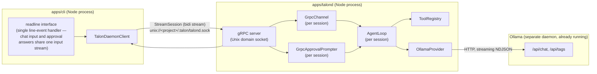
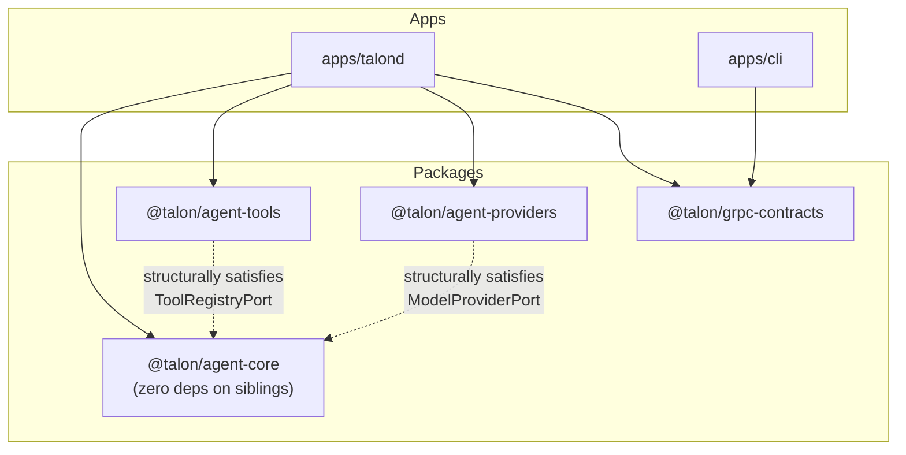
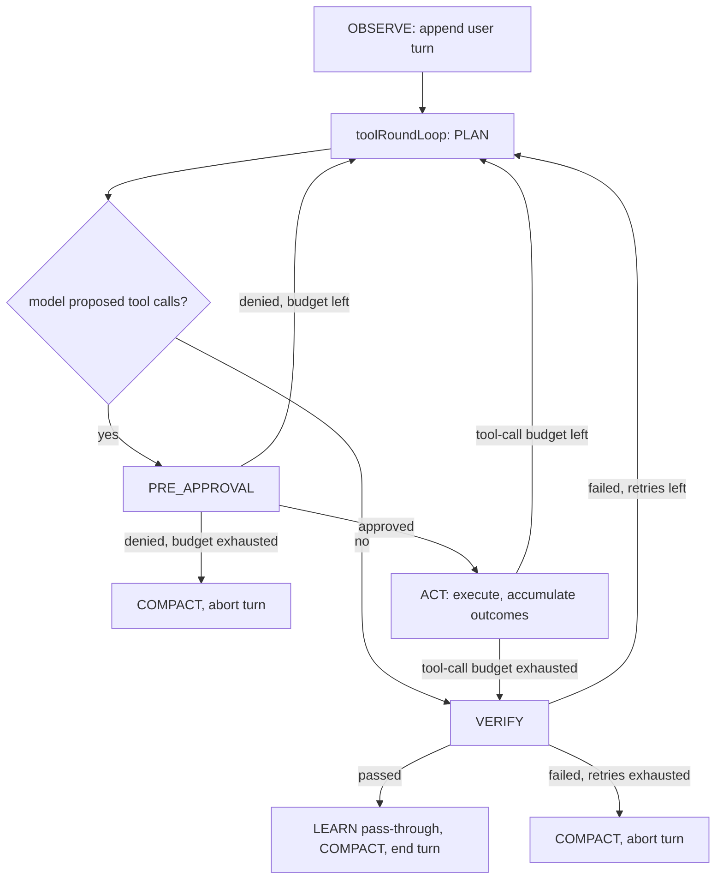

# Phase 1 Architecture — Core Engine & CLI

**Status:** implemented and verified against a live Ollama instance. See [`docs/PRD.md`](../PRD.md) for the full product spec and roadmap; this document describes what Phase 1 actually built, including a few places where real implementation diverged from the PRD's description.

## 1. Process topology

Three OS processes, two of them optional/interchangeable per session:

`talond` is the only process that ever runs `agent-core`'s loop. The CLI holds no agent state — it's a transport + terminal UI. This is deliberate (PRD §1.3/§1.4): the daemon can outlive any particular client and is what later phases' CLI-attach and remote-computer features build on.

## 2. Package map & the dependency-inversion fix

The PRD specifies that `agent-core` depends on nothing concrete outside itself, while also placing `ModelProvider` in `agent-providers` and `ToolRegistry` in `agent-tools` — both of which depend *on* `agent-core`. Taken literally, `agent-core`'s loop importing those classes to type its own constructor parameters would be a cycle.

**Resolution:** `agent-core` defines its own minimal **port interfaces** in `packages/agent-core/src/shared/ports.ts` — `ModelProviderPort`, `ToolRegistryPort`, `ApprovalGatePort` — matching the public *shape* of the real classes field-for-field, but never importing them. TypeScript's structural typing means a real `OllamaProvider` or `ToolRegistry` instance satisfies these ports with zero coupling. Only `apps/talond` imports all the packages and wires concrete instances into `AgentLoop`. `eslint.config.js`'s `eslint-plugin-boundaries` rules enforce this at lint time: `agent-core` is not allowed to import any sibling package.

One consequence worth knowing: `agent-tools`' `ToolSafetyTier` is a type+const-object (`{ SafeReadOnly: "safeReadOnly", ... } as const`), not a TS `enum`. A real `enum` is nominally typed and isn't assignable to `agent-core`'s plain string-union `ToolSafetyTierPort` without an unsafe cast — the const-object pattern sidesteps that while still giving `ToolSafetyTier.SafeReadOnly`-style access.

## 3. The agent loop

### 3.1 State machine

Implemented in `packages/agent-core/src/loop/agent-state.ts` as a discriminated union + a pure `transition()` function (not XState — a design-review decision), matching the PRD's `OBSERVE → PLAN → PRE_APPROVAL → ACT → VERIFY → LEARN → COMPACT` diagram.

### 3.2 The tool-round loop (a real fix, not in the PRD diagram)

The PRD draws `ACT → VERIFY` as a single pass. Running the real loop against Ollama showed why that's incomplete: a tool-calling model needs to see its own tool results before it can produce a final answer for the user, and may reasonably chain several tool calls first. Without accounting for this, a turn ended the instant a tool executed — the user saw the tool run but never got an answer.

`AgentLoop.runTurn()` (`packages/agent-core/src/loop/agent-loop.ts`) therefore nests two loops:

- **`toolRoundLoop`** (inner): keeps cycling `PLAN → PRE_APPROVAL → ACT` while the model keeps proposing tool calls, stopping when a `PLAN` call proposes none (a final answer) or `LoopBudget.maxToolCallsPerTurn` is exhausted.
- **`verifyLoop`** (outer): the PRD's existing retry semantics — on a failed verification, re-enter the whole tool-round process fresh, up to `LoopBudget.maxVerifyRetries` times, carrying the failure reason into context as feedback.

`LoopBudget.maxDenialReplans` (a Phase 1 addition, not in the PRD's budget table) bounds how many times a denied approval sends the loop back to re-plan before the turn aborts outright.

### 3.3 Verification (Phase 1 scope)

`verify()` is deterministic-only: did every tool call executed this turn succeed. The PRD's "falls back to a lightweight model self-check" path is deferred — Phase 1 has exactly one thing to check (tool success/failure), so there's nothing yet that needs a second model call to adjudicate.

## 4. gRPC protocol

One service, two RPCs (`proto/talon/daemon.proto`):

- **`StreamSession`** — a single bidirectional stream per session. Client → server messages are a `oneof` of `ChannelInput` (chat text) or `ApprovalDecision`; server → client messages are a `oneof` of `ChannelOutput` (streamed assistant text), `AgentEvent` (state transitions, tool-call-proposed, verification results — observability only), or `ApprovalRequest`.
- **`CheckHealth`** — unary; the CLI calls this once at startup and warns (but still proceeds) if the configured provider isn't ready.

This is deliberately *not* a new protocol: the server-side handler is a network-shaped implementation of `agent-core`'s own `Channel` interface (`GrpcChannel`) plus an `ApprovalPrompter` (`GrpcApprovalPrompter`) — talond's gRPC layer is a thin transport binding, not a second place where session logic lives.

**Demuxing one stream into two concerns:** a single `StreamSession` call carries both chat input and approval answers from the client, and both chat output and approval requests from the server. `GrpcChannel` wraps an internal `AsyncQueue<ChannelInput>` (`apps/talond/src/async-queue.ts`) that the raw gRPC `'data'` handler pushes into; `GrpcApprovalPrompter` keeps a `Map<callId, resolver>` so an `ApprovalRequest` sent out can be matched against the `ApprovalDecision` that eventually comes back, independent of the tool call's own id.

**The CLI side has the mirror-image demuxing problem, with a twist:** the terminal only has one input stream (stdin), used for both chat messages and approval y/N answers. An earlier version called `readline.question()` from two independent code paths — the main chat loop and the approval handler — which can race. The fix (`apps/cli/src/bin/talon.ts`) routes every `'line'` event through one handler: if an approval is currently pending, the line answers it; otherwise it's a chat message.

A second, related bug surfaced by actually testing the cold-start path (below): `readline` starts consuming stdin the instant it's created, regardless of whether a `'line'` listener is attached yet — a listener added later never sees lines that arrived before it existed. The `'line'` handler now attaches immediately at module load; until a gRPC call exists to send on, lines queue in a small buffer that gets flushed the moment the session is ready.

### 4.1 `talon` is a single command — daemon auto-start

The CLI never assumes a separately-running `talond`. On startup it calls `CheckHealth`; if that fails, it resolves `@talon/talond`'s installed location via `createRequire(...).resolve("@talon/talond/package.json")` (a real workspace dependency of `@talon/cli`, used only for this path resolution — the CLI still holds no agent state), spawns `node .../dist/main.js` **detached** so the daemon outlives the CLI process, and polls `CheckHealth` until it's ready (15s budget) before proceeding. A second `talon` invocation in the same project finds the already-running daemon and skips straight past this.

The default socket path changed from a single global `/tmp/talond.sock` to `<project>/.talon/talond.sock`, computed identically by both `talond` and `cli` from `TALON_PROJECT_ROOT`/`process.cwd()`. A global path would make every project share one daemon — the first one to start would silently pin every later `talon` invocation, in any directory, to its project root. Per-project sockets make each directory's daemon independent, which is what auto-start actually needs to be safe to do without asking.

## 5. Tool safety tiers & the approval flow

Three tiers (`packages/agent-tools/src/base/tool-definition.ts`), per PRD §5.1:

| Tier | Gate | Phase 1 tools |
|---|---|---|
| `safeReadOnly` | none — `agent-core`'s `preApproval()` short-circuits it | `fs.read_file`, `fs.list_dir` |
| `heuristicSandboxed` | prompted once, then auto-allowed for the rest of the session (cache keyed by tool id + arg hash) | `shell.exec`, for allowlisted commands (`git status`, `npm test`, `ls`, `pwd`) |
| `dangerousConfirmRequired` | prompted every time, never cached | `shell.exec`, for anything else |

`shell.exec`'s declared `safetyTier` is the *floor* (`heuristicSandboxed`); its `resolveTier()` override raises it to `dangerousConfirmRequired` for non-allowlisted commands — raising the floor per PRD §2.2's contract, never lowering it.

One correction made during implementation: the PRD's `ToolDefinition.resolveTier(ctx)` signature takes no `input`, but `shell.exec`'s allowlist check needs to see the proposed command — which is part of the input, not the context. The real signature is `resolveTier(ctx, input)`.

`ToolSandbox` (`packages/agent-tools/src/sandbox/tool-sandbox.ts`) wraps `execa`: pinned `cwd`, an env allowlist (`PATH`/`HOME`/`LANG` by default — no ambient credentials reach the subprocess), a wall-clock timeout, and output truncation enforced by the wrapper itself. This is parity-level isolation (restricted subprocess, not an OS sandbox/container) — a deliberate Phase 1 scope decision, not an oversight.

## 6. Provider: Ollama

`OllamaProvider` (`packages/agent-providers/src/ollama/ollama-provider.ts`) streams `/api/chat` and parses Ollama's NDJSON response — one JSON object per line, `message.content` carrying incremental text and `message.tool_calls` carrying complete (not partial) tool-call objects when present, verified against a live `qwen2.5:7b-instruct` instance rather than assumed from documentation. Ollama's own tool-call `id` is reused directly as `ProposedToolCall.id`.

## 7. Known Phase 1 simplifications

These are explicit scope decisions, not gaps to be surprised by later:

- **No persistence.** `agent-memory`'s SQLite/FTS5 tiers don't exist yet; `COMPACT` is an in-memory sliding-window trim, and `LEARN` is a pure pass-through (no `agent-skills` package yet).
- **Single built-in provider.** Only Ollama; Gemini/Apple FM/LiteRT arrive in later phases per the PRD roadmap.
- **Naive command splitting.** `shell.exec` splits on whitespace — fine for the allowlisted commands it targets, not a real shell-quoting parser.
- **No OS-level sandbox.** `ToolSandbox` restricts the subprocess (cwd/env/timeout/output caps) but doesn't containerize it.

## 8. Extending Phase 1

- **New tool:** implement `ToolDefinition` in `packages/agent-tools/src/builtin/`, add it to `registry-manifest.ts`'s `builtinTools()`. No changes needed to `agent-core` or the gRPC layer.
- **New provider:** implement `ModelProvider` in `packages/agent-providers/src/<provider>/`, matching the `CompletionRequest`/`CompletionChunk` shapes in `contract/model-provider.ts`. Wire it into `apps/talond/src/grpc-server.ts`'s `createTalonDaemonServer()`.
- **New AgentEvent variant:** add it to the union in `packages/agent-core/src/events/agent-event.ts`, extend `proto/talon/daemon.proto`'s `AgentEvent` message to match, regenerate (`pnpm --filter @talon/grpc-contracts run generate`), and add the mapping case in `apps/talond/src/grpc-server.ts`'s `toServerMessage()`.
