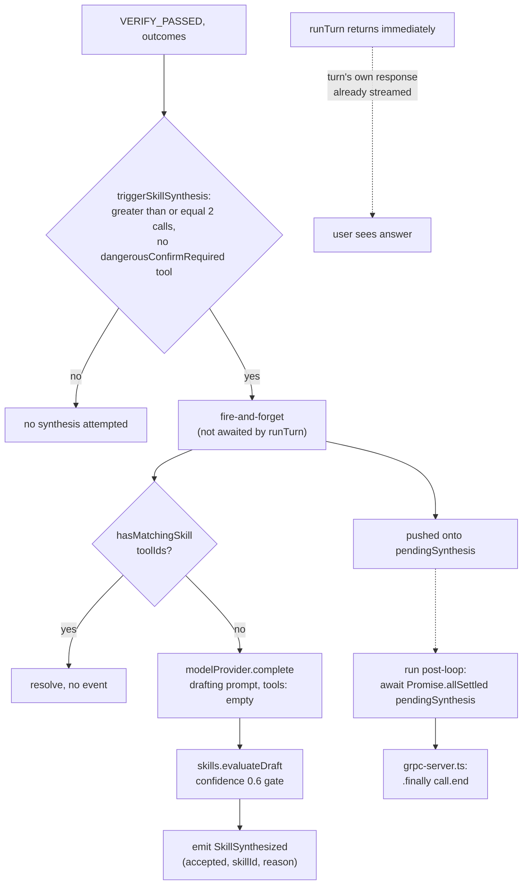

# Phase 2 Architecture — Memory & Skills

**Status:** implemented and verified against a live Ollama instance, in two independent passes — `@talon/agent-memory` first, `@talon/agent-skills` second (they share no dependency beyond `agent-core`'s `AgentEvent`). See [`docs/PRD.md`](../PRD.md) §4/§2.2/§7.2 for the spec; this document describes what Phase 2 actually built, including several places the PRD leaves genuinely underspecified and one deliberate divergence from its literal text. [`phase-1.md`](./phase-1.md) §7's "No persistence... `LEARN` is a pure pass-through" bullet is what this phase replaces.

## 1. Storage layout — per-project, not the PRD's literal global `~/.talon/`

The PRD's §4.1/§4.2/§4.3 all describe memory living under a global `~/.talon/` (`$XDG_DATA_HOME/talon` on Linux, etc.). This phase keeps everything under the **per-project** `<project>/.talon/` directory instead — the same directory Phase 1's socket already lives in, and for the same reason: `talond` is already one daemon per project (phase-1.md §4.1), so a global memory store would mean two unrelated projects' daemons silently sharing one `USER.md`/session history/skill set. Per-project storage matches the convention that already exists rather than introducing a second one.

```
<project>/.talon/              (gitignored)
  talond.sock                  Phase 1
  USER.md                      Tier 1 — static profile
  MEMORY.md                    Tier 2 — episodic log
  memory.db                    Tier 3 — SQLite FTS5 session store
  skills/*.md                  project-local skills (human-written or, eventually, synthesized)

packages/agent-skills/skills/*.md   bundled, human-authored skills — shared across every project
```

## 2. `@talon/agent-memory`

`src/{profile,episodic,fts,compaction}/` per the PRD's own directory sketch (§2.1), tied together by `MemoryStore` (`src/index.ts`).

### 2.1 `MemoryPort` — the contract the PRD never wrote

Unlike `ToolDefinition`/`BaseSkill`/`ModelProvider`, which §2.2 calls "the only extension points," the PRD gives `agent-memory` no formal interface at all. `packages/agent-core/src/shared/ports.ts` adds one, following the exact pattern already established there:

```typescript
export interface MemoryTurn {
  readonly role: "user" | "assistant" | "tool";
  readonly content: string;
  readonly toolId?: string;
}

export interface MemoryPort {
  loadProfile(): Promise<string>;
  recallEpisodic(query: string, limit: number): Promise<readonly string[]>;
  compact(turns: readonly MemoryTurn[], sessionEnding: boolean): Promise<void>;
}
```

### 2.2 `MemoryStore` vs. `MemorySession` — a real bug caught before it shipped

`apps/talond/src/grpc-server.ts`'s `streamSession` handler constructs a **new `AgentLoop` per gRPC session**, but `talond` itself is one long-lived process serving many sessions over its lifetime. A single `MemoryStore` instance tracking one mutable `sessionId`/turn-index, shared across every session, would silently merge unrelated sessions' turns into the same `sessions` row the moment a second session started. `MemoryStore` is constructed once per daemon (one shared SQLite connection, `loadProfile`/`recallEpisodic` — genuinely project-level, not session-scoped) and exposes `createSession(): MemorySession`, called once per `AgentLoop`:

```typescript
const memoryStore = await MemoryStore.open(config.projectRoot, config.model);
// ...
const loop = new AgentLoop({ ..., memory: memoryStore.createSession() });
```

`MemorySession`'s `compact()` owns its own private `sessionId`/`turnIndex` closure state — lazily creating the `sessions` row on first call, exactly mirroring how `AgentLoop` itself is freshly constructed per session.

### 2.3 Tier 1 — `USER.md` (`ProfileWriter`)

`load()`/`write()`, capped at the PRD's 2,000 tokens (§4.1) via the same `chars/4` heuristic already used by `agent-core`'s `ContextBuilder.estimateTokens()` — reimplemented locally (no cross-package import) rather than re-derived, so the two stay numerically consistent. `write()` **rejects** an over-cap write outright rather than truncating, and never partially overwrites the file on rejection. Nothing in this phase calls `write()` automatically — per the PRD, `USER.md` "changes rarely... only explicit user-approved edits or user-initiated `/forget` commands mutate it," and there's no such command yet. It exists as a capability for a future caller.

### 2.4 Tier 2 — `MEMORY.md` (`EpisodicStore` + `compaction/`)

Two filled gaps here, both documented inline in the source:

- **Recall is in-process keyword-overlap scoring, not SQLite FTS5.** The PRD's FTS5 schema (§4.3) only indexes `turns` (session transcripts); `MEMORY.md` entries are never more than ~200 short strings (the PRD's own cap), so a database index would be pure overhead. `episodic/entry.ts`'s `scoreByKeywordOverlap` is the same technique Phase 2's `agent-skills` pass later reuses for `MarkdownSkill.shouldActivate` — one heuristic, two call sites.
- **`reference_count` tracking** (§4.2's "recency_weight * reference_count" scoring input) needed a concrete definition the PRD doesn't give. This implementation counts "was retrieved and injected into context for a turn" — a deliberate simplification of "influenced a plan," which isn't observable from `OBSERVE` alone — persisted in `memory_reference_counts(entry_hash, count)`, a table **not in the PRD's §4.3 schema**, keyed by a stable hash of each entry's `date + text` so it survives file rewrites.

`compaction/compaction-plan.ts`'s `computeCompactionPlan()` is a pure function (score → 20th-percentile cutoff → keyword-cluster merge), independently unit-testable with no I/O — `episodic/episodic-store.ts`'s `compactIfNeeded()` is the thin I/O wrapper that archives pruned originals (`memory_archive`, linked via `merged_into` to the new summary's hash) and appends the merge summaries as new `MEMORY.md` entries. `recencyWeight()`'s exact formula (`1 / (1 + daysSinceEntry)`) is also a filled gap — the PRD names the scoring inputs but not the decay curve.

### 2.5 Tier 3 — SQLite FTS5 (`fts/sqlite-store.ts`)

Schema is the PRD's §4.3 verbatim (`sessions`, `turns`, `turns_fts` as an external-content FTS5 table kept in sync via `AFTER INSERT/UPDATE/DELETE` triggers — not application-level dual writes — `artifacts`, `memory_archive`, `skills_synthesized`), plus the one addition from §2.4 above. `better-sqlite3` (synchronous, WAL mode) — Phase 2 is desktop/`talond`-only, so §7.3's `expo-sqlite`/mobile FTS5 availability risk doesn't apply yet. Search is the PRD's own query pattern: `SELECT ... FROM turns_fts WHERE turns_fts MATCH ? ORDER BY rank LIMIT ?`.

## 3. `agent-core` wiring — memory

- **`context/context-builder.ts`** gained `prependSystemContext(text)` — `systemPrompt` was `private readonly`, set once in the constructor, with no way to fold a loaded `USER.md` in afterward. `buildMessages()` now joins `[systemPrompt, ...extraSystemContext]` for the system message.
- **`loop/agent-loop.ts`**: `run()` loads the profile once per session, before the turn loop, via `context.prependSystemContext`. `runTurn()`'s `OBSERVE` step calls `memory.recallEpisodic(input.text, 5)` and injects any hits as a synthetic `system`-role turn **directly via `context.addTurn()`**, not through the `addTurn()` wrapper below — recalled context shouldn't be persisted back into the transcript it was recalled from. A private `addTurn()` wrapper mirrors every *real* conversational turn (user text, assistant text, the denial/retry notices, tool results) into both the live context and a `pendingMemoryTurns` buffer. `compact(sessionEnding = false)` drains that buffer into `memory.compact(...)` on every existing Phase 1 compact call site (all pass `sessionEnding: false`), plus once more, unconditionally, right before `run()` returns — the one call that actually marks a session's `ended_at`, since none of the in-turn call sites represent the *session* ending (only the turn).

## 4. `@talon/agent-skills`

`src/{parser,catalog,loader,synthesizer}/` per the PRD's directory sketch, tied together by `SkillCatalog` (`src/catalog/skill-catalog.ts`).

### 4.1 `BaseSkill` is a TS class; every real skill is a Markdown file

§2.2 gives `BaseSkill` a full abstract-class contract — including an abstract `shouldActivate(ctx): boolean` — but every actual skill (human-authored under `packages/agent-skills/skills/*.md`, synthesized ones eventually under `<project>/.talon/skills/*.md`) is a parsed Markdown file. A `.md` file can't implement a custom TS method. `src/skill.ts`'s `MarkdownSkill extends BaseSkill` gives every Markdown-sourced skill the *same* generic, pure, I/O-free Stage-1 match: keyword overlap between `triggerSummary` and the turn's text (§13's real two-stage semantic pipeline is explicitly Phase 4 scope — there's no intent classifier yet, so `userIntentSummary` is just the turn's raw text).

### 4.2 `SkillsPort`

Mirrors `MemoryPort`'s shape — all-async, even though `SkillCatalog`'s own work is synchronous under the hood, so it satisfies the port directly with no adapter:

```typescript
export interface SkillsPort {
  listCatalog(): Promise<readonly SkillCatalogEntryPort[]>;
  activate(ctx: SkillActivationContextPort): Promise<readonly SkillActivationPort[]>;
  hasMatchingSkill(toolIds: readonly string[]): Promise<boolean>;
  evaluateDraft(rawDraftText: string): Promise<SkillDraftEvaluationPort>;
}
```

### 4.3 `SkillCatalog`: bundled + project roots, and a real `exports`-map pitfall

`SkillCatalog.open(projectRoot)` scans both roots once (bundled `packages/agent-skills/skills/*.md`, project `<projectRoot>/.talon/skills/*.md` — absent until anything writes there, which nothing does yet) and is otherwise stateless: which skills have already activated *this session* is tracked by the caller (`AgentLoop`'s `activeSkillIds`), not held here, so one `SkillCatalog` is safely shared across every concurrent `AgentLoop`.

Resolving the bundled directory hit a real gotcha worth documenting: the obvious approach — mirroring `apps/cli`'s `createRequire(...).resolve("@talon/talond/package.json")` pattern for finding `@talon/talond`'s install location — **doesn't work here**, because `agent-skills`' `package.json` declares an `exports` map with only `"."`. Node's self-reference resolution only resolves subpaths actually listed in `exports`, and `package.json` isn't one of them; `apps/cli` resolving `@talon/talond` works only because *apps* declare no `exports` field at all, so no such restriction applies. `loader/skill-files.ts`'s `resolveBundledSkillsDir()` instead derives the path from `import.meta.url` (this module's own compiled location, `dist/loader/skill-files.js` → package root → `skills/`) — works regardless of how the package is linked, and doesn't depend on a `package.json` subpath being exported at all.

A malformed `.md` file (missing `id`/`trigger_summary`) is `SKILL_PARSE_ERROR` territory (§12): `parser/skill-parser.ts`'s `parseSkillFile()` returns `undefined` rather than throwing, and `SkillCatalog.open()` skips it with a `console.warn`, never crashing the whole catalog load.

### 4.4 Progressive disclosure, end to end

`agent-loop.ts`'s `run()` loads `listCatalog()` once per session and folds the "unexpanded index" (`id: triggerSummary` per line) into the system prompt via `prependSystemContext` — the same mechanism Section 3 uses for the loaded `USER.md`. Per turn, `OBSERVE` calls `activate(ctx)` with the turn's text, the rolling `recentToolIds` window (capped at 10), and the session's `activeSkillIds`; each match's full `body` is injected as its own system turn (same "recalled, not persisted" treatment as episodic memory) and its id is added to `activeSkillIds` so it isn't re-injected later in the same session.

## 5. The synthesizer — real drafting, fire-and-forget

Confirmed scope (not a PRD-literal default): Phase 2's synthesizer makes a **real model call** to draft a `SKILL.md` candidate when its trigger conditions fire — not just trigger-detection logging — with the outcome reported via a new `SkillSynthesized` `AgentEvent`. Nothing is ever written to disk or to the `skills_synthesized` table; §7.2 explicitly scopes Phase 2 to "no auto-write yet — logged only."

**Trigger conditions**, checked in `agent-loop.ts`'s new `triggerSkillSynthesis(outcomes)` (called from the `VERIFY_PASSED` branch, replacing Phase 1's "no agent-skills package yet" comment):

1. `outcomes.length >= 2` (§4.4's own threshold — a single-call task isn't worth skill-ifying).
2. **No tool in `outcomes` resolved to `dangerousConfirmRequired`.** This is this implementation's resolution of §4.4's tier-preservation gate ("no `dangerousConfirmRequired` tool appears in the skill without that tier being preserved"), which has nothing to bite on in practice: the draft `SKILL.md` format (per the PRD's own worked example) carries no per-tool tier claim at all, and the PRD itself notes `ApprovalGate` independently re-resolves the effective tier at execution time regardless of what synthesis assumed — "two non-overlapping safety nets." Rather than parse free-text for an implied tier claim the format can't express, a turn that needed full manual confirmation is simply never eligible for synthesis.
3. `!await skills.hasMatchingSkill(toolIds)` (§4.4's second condition) — exact ordered-array equality against every cataloged skill's `recommendedToolIds`. (`recommended_tool_ids` as a comma-separated frontmatter field is itself a small format extension beyond the PRD's one worked example, which never shows this field — added since the match check needs *something* on the skill side to compare against, and every draft this phase ever produces goes unwritten anyway.)

If eligible, `synthesizeSkillDraft()` runs **without `await`** from the caller — fire-and-forget, per the PRD's "not awaited by the user-facing response." It calls `modelProvider.complete()` with a drafting prompt (`tools: []`, plain text generation) asking for a candidate in exactly the frontmatter shape `evaluateDraft`/`parseSkillFile` expect, then hands the raw text to `skills.evaluateDraft()`, which checks the one gate still meaningful given point 2 above — `confidence >= 0.6` — and emits `SkillSynthesized { accepted, skillId?, reason }`.

**A race the PRD's phrasing doesn't rule out, fixed here:** each fire-and-forget promise is pushed onto `pendingSynthesis` (wrapped in its own `.catch`, so a drafting failure can't produce an unhandled rejection — it still emits a `SkillSynthesized{accepted:false}` instead). `run()` awaits `Promise.allSettled(pendingSynthesis)` before it returns, so an in-flight draft can never try to `call.write(...)` after `grpc-server.ts`'s `.finally(() => call.end())` has already fired.



## 6. gRPC protocol addition

`proto/talon/daemon.proto`'s `AgentEvent` oneof gains `SkillSynthesized skill_synthesized = 5` (`bool accepted`, `string skill_id`, `string reason`) — regenerated automatically via the existing `@talon/grpc-contracts` build step, same as every prior proto change. `apps/talond/src/grpc-server.ts`'s `toServerMessage()` gained the matching case.

## 7. Known Phase 2 simplifications

Explicit scope decisions, not gaps to be surprised by later:

- **Per-project storage, not the PRD's global `~/.talon/`** (§1).
- **No real intent classification.** Both `MEMORY.md` recall and `MarkdownSkill.shouldActivate` are Stage-1-only keyword overlap; §13's embedding-based Stage 2 and the three-bucket intent classifier are Phase 4 scope.
- **No crash/restart reconciliation for `sessions` rows.** A `talond` crash mid-session leaves `ended_at IS NULL` with no explicit cleanup — the PRD doesn't specify one either; searchability (the Phase 2 exit criterion) doesn't require it.
- **Synthesized skills are never written.** Draft + Evaluate run for real against a live model; Write never happens in this phase (§7.2).
- **No OS-level sandbox change.** Memory/skills I/O goes through plain `node:fs`/`better-sqlite3`, same trust boundary as everything else `talond` already touches locally.

## 8. Extending Phase 2

- **New memory tier or recall source:** add it to `MemoryStore`/`MemorySession` in `packages/agent-memory/src/index.ts`; `MemoryPort` only needs a new method if `agent-core`'s loop itself needs to call it directly.
- **New skill source** (e.g. an actual write path for synthesized drafts): extend `SkillCatalog.open()`'s root-scanning in `packages/agent-skills/src/catalog/skill-catalog.ts` — `agent-core` never changes, since it only ever sees `SkillsPort`.
- **New `AgentEvent` variant:** same recipe as phase-1.md §8 — add it to the union in `agent-event.ts`, extend `daemon.proto`'s `AgentEvent` message, regenerate, add the `toServerMessage()` case.
