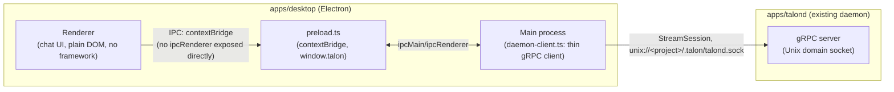

# Phase 3 Architecture — Electron Desktop Shell

**Status:** implemented and verified against a live Ollama instance + a real launch of the packaged Electron app (cold daemon auto-start, chat round-trip, process topology all confirmed by actually running it, not inferred from the code). See [`docs/PRD.md`](../PRD.md) §1.3/§1.4/§7.2 for the spec and [`phase-1.md`](./phase-1.md) for the gRPC/approval contract this shell is a second client of. `apps/mobile` (the other half of Phase 3's scope) is not covered here — this document is `apps/desktop` only.

## 1. Process topology — exactly PRD §1.3's picture, no divergence



Electron's main process is a second thin gRPC client of `talond`, structurally identical to `apps/cli` (§1.4's "Electron and the CLI are thin gRPC clients that never host agent logic themselves") — it runs `agent-core`'s loop nowhere; `talond` still does. The renderer is UI-only, reaching `talond` only through `preload.ts`'s `contextBridge.exposeInMainWorld("talon", ...)`, never through a direct `ipcRenderer`/Node import (`contextIsolation: true`, `nodeIntegration: false` — PRD §1.3's "ELECTRON_RENDERER -->|IPC: contextBridge| ELECTRON_MAIN" arrow, implemented literally).

## 2. Two real bugs caught by actually running it, not inferable from the code

Both of these are specific to Electron's main process being a *different* runtime from a plain Node process — `apps/cli`'s existing `ensureTalondRunning` logic doesn't carry over by copy-paste.

### 2.1 `process.execPath` is Electron, not Node

`apps/cli/src/bin/talon.ts`'s cold-start spawn (`spawn(process.execPath, [talondMain], ...)`) relies on `process.execPath` being a real Node binary — true for a plain Node CLI process, false inside Electron's main process, where it points at the Electron binary itself. The naive port of that line spawns a *second Electron instance* that treats `talondMain` (a `.js` path) as an app-path argument and never reaches `main.js`'s own code at all — no error, no crash, just a daemon that silently never starts (caught by noticing no socket file ever appeared, not any thrown exception).

The next-most-obvious fix — `spawn(process.execPath, [talondMain], { env: { ELECTRON_RUN_AS_NODE: "1" } })`, Electron's documented way to make its own binary behave like plain Node for one child process — **also turned out wrong**, for a subtler reason (§2.2).

### 2.2 `ELECTRON_RUN_AS_NODE` runs the right file under the wrong Node ABI

With `ELECTRON_RUN_AS_NODE=1`, the spawned child does run `talond`'s `main.js` — but under Electron's own bundled Node (`NODE_MODULE_VERSION 127` as of Electron 44.9.2), not the system Node this workspace's dependencies were actually compiled against (`149`, Node 22). `talond` crashed immediately and deterministically on `MemoryStore.open()`'s first `better-sqlite3` `dlopen` call:

```
Error: The module '.../better_sqlite3.node' was compiled against a different
Node.js version using NODE_MODULE_VERSION 127. This version of Node.js
requires NODE_MODULE_VERSION 149.
```

`better-sqlite3` is a native addon; Electron's bundled V8/Node and the system Node are different ABI targets even when both satisfy `engines.node`. **Fix:** `daemon-client.ts`'s `ensureTalondRunning` spawns the bare command `"node"` (not `process.execPath`, with or without the env flag) and lets the OS resolve it via `PATH` — the same binary `apps/cli`'s own shell already runs `talond` with. This is a real, intentional **dev-loop scope limit**, not an oversight: a packaged, double-clicked Electron app has no guarantee of a `PATH`-reachable Node at all (GUI-launched apps get a minimal environment on macOS). Phase 3 doesn't solve that — `apps/talond/package.json`'s existing `pkg`-compiled standalone binary (phase-1.md §8) is the right target to spawn instead once packaging is actually in scope; this is a packaging-time concern flagged for later, not a Phase 3 blocker, since Phase 3's own exit criteria (§7.2) only asks for feature parity in a running dev build.

## 3. Approval UI: the PRD's two mentions of this disagree, and this implementation follows the more specific one

§1.4's deployment-strategy table says desktop approval UI is "native Electron notification"; §5.1's actual permissions matrix says "native Electron dialog." A `Notification` has no reliable, cross-platform interactive action-button API in Electron for a yes/no decision; `dialog.showMessageBox` does, and is the one of the two descriptions actually detailed enough to implement against. This build follows §5.1 — **only** for `dangerousConfirmRequired`, which is also where §5.1 says it's mandatory and never cached:

- `main.ts`'s `resolveApprovalWithNativeDialog()` calls `dialog.showMessageBox` (modal, blocking) when `ApprovalRequest.safetyTier === "dangerousConfirmRequired"` — resolved entirely in the main process, the renderer never even sees this request.
- Every other tier that reaches `PRE_APPROVAL` at all (in practice, only `heuristicSandboxed` — `safeReadOnly` never generates an `ApprovalRequest`) is forwarded to the renderer as `talon:approval-request` and rendered as an inline, non-modal banner with Approve/Deny buttons (§5.1's "single lightweight in-flow confirmation (not biometric)").

Routing both tiers through the same native dialog would make a routine sandboxed `git status` confirmation as disruptive as a destructive-command confirmation, defeating the reason the matrix has two tiers in the first place.

## 4. IPC contract — `shared/ipc-channels.ts`

Plain-JSON mirrors of the subset of gRPC messages the UI actually renders (not every `AgentEvent` variant — `ToolCallProposed`/`ToolCallDelta` are logged by neither this UI nor `apps/cli` today, same scope cut both places). Channel names and payload shapes live in one file, imported by both `main.ts`/`daemon-client.ts` and `preload.ts`; the renderer deliberately does **not** import this same module's sibling `TalonApi` type from `preload.ts` (see `renderer/global.d.ts`'s comment) — pulling a main-context module into the renderer's DOM-lib `tsconfig.renderer.json` compilation would make `tsc` emit it a second time under different `lib`/`types` settings, silently overwriting the real build. `global.d.ts` re-declares the `window.talon` shape instead — two sides of an IPC boundary agreeing by construction, the same relationship a generated gRPC client/server pair already has.

## 5. Build layout — two `tsc` projects, one package

```
apps/desktop/
  tsconfig.json           main + preload + shared (Node context, references grpc-contracts)
  tsconfig.renderer.json   renderer + shared (DOM lib, types: [] — no ambient @types/node leakage)
  src/{main,preload,renderer,shared}/
  scripts/copy-static.mjs  tsc only emits .ts -> .js; index.html/styles.css need a plain copy into dist/renderer
```

No bundler (esbuild/Vite/webpack) for the renderer — it's a single `<script type="module">` loading `renderer.js` directly, consistent with the project's existing "minimal moving parts" posture (PRD §1.2/§7.3's `pkg`-bundling discussion is the one place this repo *does* need a bundler, for an unrelated reason). `pnpm run build` is `tsc -b && tsc -p tsconfig.renderer.json && node scripts/copy-static.mjs` — folds into the existing root `turbo run build` pipeline with zero `turbo.json` changes, since `apps/*` is already a wildcard-matched workspace.

## 6. Known Phase 3 (desktop) simplifications

- **No installer/packaging step.** `electron-builder`/`electron-forge` aren't wired up; `pnpm --filter @talon/desktop start` runs the dev build directly. Phase 3's exit criteria (§7.2) is feature parity, not a shippable installer.
- **`ensureTalondRunning` requires a `PATH`-reachable system Node** (§2.2) — fine for this dev loop, a real gap for a packaged app, deliberately deferred to a packaging pass that spawns `apps/talond`'s `pkg`-compiled binary instead.
- **One window, one session.** No multi-window/multi-project support — matches `apps/cli`'s own one-process-one-session model today.
- **`ToolCallProposed`/`ToolCallDelta` aren't rendered**, same scope cut as `apps/cli`.

## 7. Extending this shell

- **New renderer UI surface:** `renderer.ts` + `index.html`/`styles.css`, reading from the same `window.talon.on*` callbacks — no main-process change needed unless it's a new kind of event.
- **New IPC message:** add the channel + payload type to `shared/ipc-channels.ts`, a case in `preload.ts`'s `talonApi`, the matching handler in `main.ts`, and the matching type in `renderer/global.d.ts` (kept in sync by hand — see §4).
- **New `AgentEvent` variant:** same recipe as phase-1.md §8 — once `daemon.proto`/`agent-event.ts` have it, add a case to `main.ts`'s `toAgentEventPayload()` and `renderer.ts`'s `onAgentEvent` switch.
