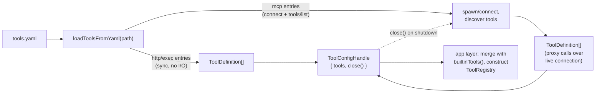

# Design: YAML Tool Configuration for `agent-tools`

**Status:** implemented, including the §7–9 follow-ups (secrets store, directory discovery, hot reload). See [`docs/PRD.md`](../PRD.md) §2.2 for the existing `ToolDefinition` contract and registration lifecycle, and [`docs/architecture/phase-1.md`](./phase-1.md) §5 for the tiers and sandbox this design extends rather than replaces.

## 1. Motivation

Every tool registered today is a hand-written `ToolDefinition` subclass living in `packages/agent-tools/src/builtin/`, added to `registry-manifest.ts`'s const array. That's appropriate for tools that need real logic (`shell.exec`'s allowlist check, `fs.read_file`'s path containment) but is a lot of ceremony for the common case of "call this one HTTP API" or "run this one local script" — cases where the entire tool is a static template, not code.

This document proposes a second, **data-driven** registration path: a single YAML file, loaded once at app startup, that declares tools of three kinds — `http` (templated REST calls), `exec` (templated local executables), and `mcp` (auto-discovered tools from a Model Context Protocol server) — and turns each into a real `ToolDefinition` without the contributor writing TypeScript.

### 1.1 This is a deliberate departure from §2.2, not an oversight

The PRD is explicit that registration has **no reflection, no global mutable registry** — a tool is a TS class, statically added to an array. A YAML loader that constructs `ToolDefinition` instances at runtime from user-editable config is exactly the pattern §2.2 rules out for the code-based path. This design does not change that path; `builtinTools()` keeps working exactly as it does today. It adds a **parallel** path for config-declared tools, with its own trust model (§3), because the two kinds of tool have different authors: a contributor who can open a PR and pass lint/review, versus a user editing a local file that isn't code-reviewed at all. Anyone extending this design should read it as "a second extension point," not as a loosening of the first one.

### 1.2 Why three kinds in one schema

`http` and `exec` are structurally the same shape — one YAML entry declares exactly one tool, fully templated by its author. `mcp` is different: one entry declares a *connection*, and the tools it registers are discovered from the server at load time, not written by the person editing the YAML. These were kept in one schema (`tools:`, `kind:` discriminator) rather than a separate `mcpServers:` section, because from the app layer's point of view they're still "things that become entries in the tool set passed to `ToolRegistry`" — the discriminator is where the real behavioral branch lives, not the top-level file structure.

## 2. Schema

One file, one list, discriminated by `kind`. A runnable example covering all three kinds lives at [`packages/agent-tools/examples/tools.example.yaml`](../../packages/agent-tools/examples/tools.example.yaml) — copy it, swap in real ids/urls/commands, and point `TALON_TOOLS_CONFIG` at the result.

```yaml
tools:
  - kind: http
    id: weather.lookup
    description: "Look up current weather for a city."
    allowedHosts: ["api.weather.example.com"]
    method: GET
    url: "https://api.weather.example.com/v1/current"
    query:
      city: { fromInput: city }
    headers:
      Authorization:
        fromEnv: WEATHER_API_KEY
        prefix: "Bearer "
    inputSchema:
      type: object
      properties:
        city: { type: string }
      required: [city]

  - kind: exec
    id: repo.lint_diff
    description: "Run the project's linter against currently staged files."
    command: "npm"
    args: ["run", "lint", "--", { fromInput: filePath }]
    cwd: "./packages/web"
    envAllowlist: ["PATH", "HOME", "NODE_ENV"]
    inputSchema:
      type: object
      properties:
        filePath: { type: string }
      required: [filePath]

  - kind: mcp
    id: figma
    transport: stdio
    command: ["npx", "-y", "@figma/mcp-server"]
    # every tool the server reports via tools/list is registered as
    # "figma.<serverToolName>", e.g. "figma.get_file"

  - kind: mcp
    id: websearch
    transport: stdio
    command: ["npx", "-y", "tavily-mcp@latest"]
    # "env" sets variables on the *spawned* process — here, the var
    # tavily-mcp itself reads for auth. Resolved the same {fromEnv}/
    # {fromSecret} way as an "http" entry's headers (only valid for
    # transport: "stdio"; a connect-time error for transport: "http").
    env:
      TAVILY_API_KEY: { fromEnv: TAVILY_API_KEY }
```

`inputSchema` is plain JSON Schema (draft 2020-12, per the existing `ToolDefinition.inputSchema` contract), authored directly as YAML — no new schema language, since YAML is a structural superset of JSON for this purpose. `mcp` entries don't declare `inputSchema`/`description` themselves; those come from the server's own `tools/list` response.

### 2.1 Structured input binding — no string templates

Both `http` and `exec` substitute the model's validated tool-call input into the request using `{fromInput: <field>}`, never string interpolation:

- `exec.args` is a list where each element is a literal or `{fromInput: field}`; the resolved list is passed straight to `execa(command, args)` — never joined into a shell string. This is the injection-safety gap `shell.exec`'s own code comments flag as out of scope for its naive whitespace-split (`packages/agent-tools/src/builtin/shell-exec.ts:46`); config-declared tools don't get to inherit that gap.
- `http.url` is a literal (no substitution); `query`, `headers`, and `body` fields are built from literals or `{fromInput: field}`, with each substituted value typed and URL-/header-encoded individually — never spliced into a larger template string.

Secrets follow the same no-interpolation rule via a distinct marker, `{fromEnv: VAR_NAME, prefix?: string}`: the YAML file never contains a secret value, only the name of an environment variable to read at call time. A referenced env var that's unset is a load-time error, not a silently empty header.

## 3. Trust model: tier floors by kind

`safetyTier` today is a fact a TS tool author asserts in code, trusted as the approval gate's floor. A YAML file is user-editable data, not reviewed code — so a config-declared entry is **not** trusted to self-assign an arbitrarily permissive tier. Each `kind` has a floor; an entry's optional `safetyTier:` field may raise above its floor (same "raise, never lower" rule `ToolDefinition.resolveTier` already follows — see phase-1.md §5) but may not go below it:

| `kind` | Condition | Floor |
|---|---|---|
| `exec` | always | `heuristicSandboxed` |
| `http` | `method: GET` (default) | `heuristicSandboxed` |
| `http` | `method` is `POST`/`PUT`/`PATCH`/`DELETE` | `dangerousConfirmRequired` |
| `mcp` | every tool the server reports | `dangerousConfirmRequired` |

An entry whose declared `safetyTier` is below its floor is a load-time validation error (§6), not a silent clamp — the person editing the file finds out immediately, not the first time the tool is invoked.

`mcp` tools floor at the top tier unconditionally because, unlike `http`/`exec`, the YAML author isn't the one who wrote the tool's behavior — the connected server is, and it can expose new tools or change what existing ones do between runs without the local config changing at all.

## 4. `http` execution safety

`ToolSandbox` (phase-1.md §5) already wraps `execa` with pinned `cwd`, an env allowlist, a timeout, and output truncation — `exec` entries reuse this unchanged (with optional per-entry `cwd`/`envAllowlist` overrides, mirroring the existing defaults-plus-opt-in-widening shape). `http` entries need an equivalent for network calls, since a raw `fetch()` has none of that discipline and additionally opens an SSRF surface `exec` doesn't have — a URL is attacker-steerable in a way an allowlisted shell command isn't.

This design adds `ToolSandbox.fetch()`:

```typescript
export interface SandboxFetchOptions {
  readonly allowedHosts: readonly string[];
  readonly timeoutMs?: number;
  readonly maxResponseBytes?: number;
  readonly cancellation?: AbortSignal;
}

export interface SandboxFetchResult {
  readonly status: number;
  readonly body: string;
  readonly truncated: boolean;
}
```

Every `http` entry must declare `allowedHosts`. `sandbox.fetch()` enforces, in addition to the usual timeout and response-size cap (mirroring `exec`'s `DEFAULT_TIMEOUT_MS`/`DEFAULT_MAX_OUTPUT_BYTES`):

- the resolved host of the request — and of every redirect hop, not just the initial URL — must match an entry on `allowedHosts`;
- literal IP addresses, `localhost`, and link-local/metadata ranges (`169.254.0.0/16`, etc.) are rejected outright, even if explicitly listed, closing off the most common SSRF targets regardless of what the YAML author intended to allow.

## 5. Loading and lifecycle

`http` and `exec` entries are pure data — turning them into `ToolDefinition` instances needs no I/O. `mcp` entries are not: discovering a server's tools means actually connecting to it (spawning a stdio subprocess, or opening an HTTP/SSE connection) and calling `tools/list`, and for stdio transport that child process has to stay alive for the session, not get spawned-and-discarded per call.

`agent-tools` exports one async loader that accounts for both:

```typescript
export interface ToolConfigHandle {
  readonly tools: readonly ToolDefinition[];
  close(): Promise<void>;
}

export function loadToolsFromYaml(
  configPath: string,
  projectRoot: string,
  secretsPath?: string,
): Promise<ToolConfigHandle>;
```

`http`/`exec` entries resolve immediately inside this call; `mcp` entries connect during it, and their discovered tools proxy calls back over the now-live connection. The app layer — `apps/talond` or `apps/cli`, per §2.2's "app layer decides the tool set" rule — awaits it once at startup, merges the result with `builtinTools()`, and calls `close()` on shutdown (tearing down any live MCP connections, e.g. killing stdio child processes):

```typescript
const { tools: configTools, close } = await loadToolsFromYaml(config.toolsConfigPath, projectRoot);
const registry = new ToolRegistry([...builtinTools(projectRoot), ...configTools]);
// ...
process.on("SIGTERM", async () => {
  await close();
  // ... existing shutdown
});
```

`configPath` may be a single file, or a directory (§8); either way, `agent-tools` only reads whatever path the app layer explicitly hands it — there is no implicit, unprompted filesystem discovery.



## 6. Load-failure semantics

Any invalid entry — unknown `kind`, a missing required field, a `safetyTier` below its kind's floor, an `id` that collides with a builtin tool or another entry in the same file, **or an id declared in two different files of a directory config (§8)** — fails the **entire** load. `loadToolsFromYaml` rejects with an error naming the offending entry (file, index, and reason); the app fails to start rather than silently running with part of its configured tool set missing. This matches how a code-level mistake in `registry-manifest.ts` would already fail the build — a config-level mistake gets the same visibility, not a quieter failure mode just because it's YAML instead of TypeScript.

This is the *startup* failure mode. §9's hot reload deliberately does **not** reuse it as-is for a live reload — see §9.

`mcp`-discovered tool names are namespaced as `<entryId>.<serverToolName>` specifically to make this kind of collision unlikely in the common case, but the check is unconditional — a collision there is just as fatal as a collision between two hand-written `http` entries.

## 7. Secrets store

`{fromEnv}` (§2.1) covers the common case, but is awkward when many entries need to share one credential without duplicating it as a literal env var per entry, or when env vars simply aren't where a user wants to keep this. This adds a second, optional binding:

```typescript
export interface SecretRef {
  readonly fromSecret: string;
  readonly prefix?: string;
}
```

usable anywhere `{fromEnv}` is (today: `http` entries' `headers` and `mcp` stdio entries' `env`). The backing store is deliberately minimal — a flat YAML/JSON mapping of secret name to string value, loaded once per `loadToolsFromYaml`/`watchToolsFromYaml` call via a `secretsPath` argument:

```yaml
# secrets.yaml
WEATHER_API_KEY: "sk-abc123"
```

No OS keychain integration, no nesting — matching this project's "BYO infra, minimal moving parts" posture elsewhere (PRD §1.2/§15.1/§16.1) rather than introducing a new per-platform native dependency for what is, functionally, a `.env`-shaped file the user is expected to gitignore. Exactly like `{fromEnv}`, the YAML tool-config file itself never contains a secret *value* — only the name used to look one up — and a reference to a missing secret, or to `{fromSecret}` with no `secretsPath` configured at all, is a hard error at call time, not a silently empty header. A runnable example lives at [`packages/agent-tools/examples/secrets.example.yaml`](../../packages/agent-tools/examples/secrets.example.yaml).

## 8. Directory-based discovery

`loadToolsFromYaml`'s `configPath` may be a directory instead of a single file — a flat (non-recursive) glob of `*.yaml`/`*.yml` fragments within it, read in sorted order for reproducible error messages. This is for managing many tool definitions across files (e.g. one file per external API) without one large file. Within-file duplicate ids are rejected the same way as before (§6); duplicate ids **across** files in the same directory are also rejected, with the error naming both files — `parseToolConfigFile` only ever sees one file at a time, so this check lives in `loadToolsFromYaml`'s aggregation loop, one layer up.

Recursive subdirectories were deliberately left out — there's no clear ordering/namespacing benefit over a flat directory for this use case, and it's easy to add later without breaking anything if it turns out to matter.

## 9. Hot reload

`watchToolsFromYaml(configPath, projectRoot, { secretsPath?, onReload?, onError? })` wraps `loadToolsFromYaml` with a file watcher:

```typescript
export interface WatchToolsOptions {
  readonly secretsPath?: string;
  readonly debounceMs?: number;
  readonly onReload?: (tools: readonly ToolDefinition[]) => void;
  readonly onError?: (error: unknown) => void;
}

export function watchToolsFromYaml(
  configPath: string,
  projectRoot: string,
  options?: WatchToolsOptions,
): Promise<ToolConfigHandle>;
```

**The initial load still fails fast**, exactly like `loadToolsFromYaml` on its own (§6) — starting the app with a broken config is exactly as wrong here as it always was. What's different is everything *after* startup: a config edit that fails to parse or validate must not take down an already-running daemon over what might be a mid-save typo. So a failed reload is reported via `onError` and the previously active tool set — including any already-open `mcp` connections — keeps serving completely unchanged, as if the bad edit never happened. The next valid edit reloads normally; one bad edit never permanently wedges the watcher.

A successful reload fully loads the new tool set (including connecting any new `mcp` servers) *before* closing the previous one's connections, so there's never a gap where no connection is live for a config-declared tool. The app layer applies the new set by calling `ToolRegistry.reset()` (§ below) from its `onReload` callback — `watchToolsFromYaml` itself has no idea `ToolRegistry` exists; it just hands back the new `ToolDefinition[]`.

**Watching a file survives an atomic save.** Editors commonly save by writing a temp file and renaming it over the original; on some platforms, `fs.watch` tied to a file's original inode stops reporting changes after exactly that rename. To avoid depending on that platform quirk, `watchToolsFromYaml` always watches the *parent directory* (filtering by basename when `configPath` is a single file) rather than the file path itself — which, as a side effect, is also exactly what directory-config (§8) needs anyway, since the relevant file *set* can change, not just one file's contents.

### `ToolRegistry.reset()`

Hot reload needs some way to swap a running `ToolRegistry`'s contents without changing its object identity (every live `AgentLoop` holds a reference to the one shared instance). `ToolRegistry` gained:

```typescript
reset(tools: readonly ToolDefinition[]): void;
```

which validates the **entire** new set for duplicate ids (the same check the constructor already does, now shared via a private `buildMap` helper) before committing anything — a rejected `reset()` leaves the previous map completely untouched, never half-updated. The app layer's `onReload` callback calls `registry.reset([...builtinTools(projectRoot), ...newConfigTools])` inside its own `try/catch`, logging and discarding on rejection (e.g. a reloaded config now collides with a builtin id) rather than propagating — consistent with §9's "a bad reload never takes the daemon down" rule.

In-flight tool calls need no special handling: `ToolRegistry.execute()` looks up `byId` once per call and hands the resolved `ToolDefinition` instance directly to the caller, so a call already dispatched against the pre-reload instance runs to completion unaffected by a `reset()` that happens mid-flight — only *future* lookups see the new set.

## 10. Remaining out of scope

- **MCP tool-level trust overrides.** Every `mcp`-discovered tool still floors at `dangerousConfirmRequired` with no per-tool or per-server exception. A "trust this specific server's tools at a lower tier" escape hatch is plausible future work but isn't designed here.

## 11. Extending this design

Consistent with phase-1.md §8's existing "Extending Phase 1" conventions:

- **New YAML `kind`:** add a discriminated variant to the config schema, its floor to the table in §3, and a `ToolDefinition`-constructing branch inside `loadToolsFromYaml`. No changes needed to `agent-core`, `ToolRegistry`, or the approval gate — they only ever see `ToolDefinition` instances, same as today.
- **New sandbox primitive** (if a future `kind` needs something other than subprocess exec or HTTP fetch): add a method to `ToolSandbox` alongside `exec()`/`fetch()`, carrying the same timeout/cap/allowlist discipline both already have.
